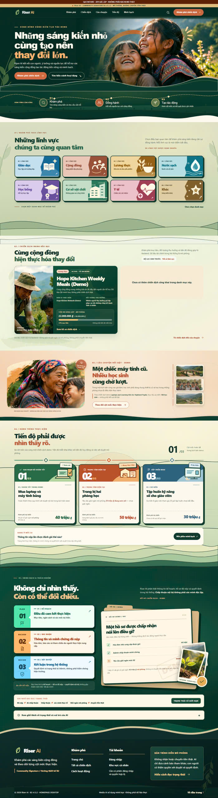
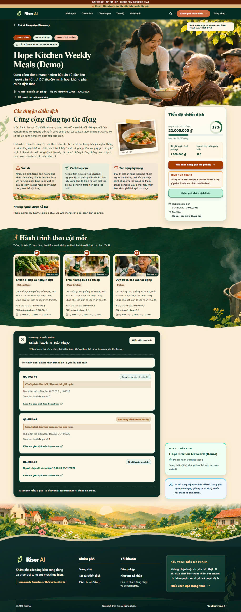
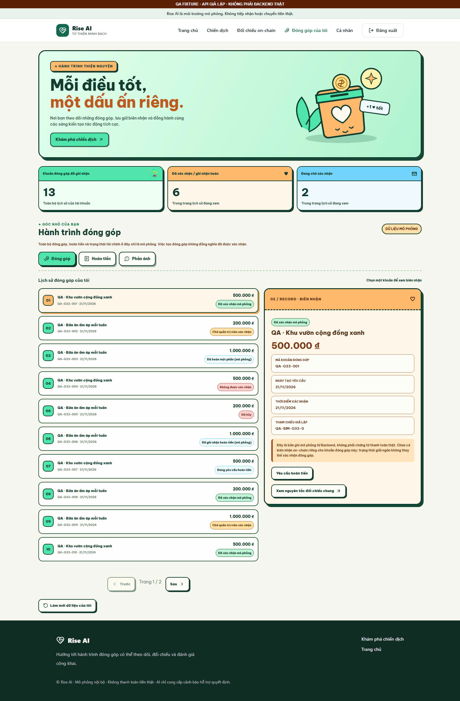
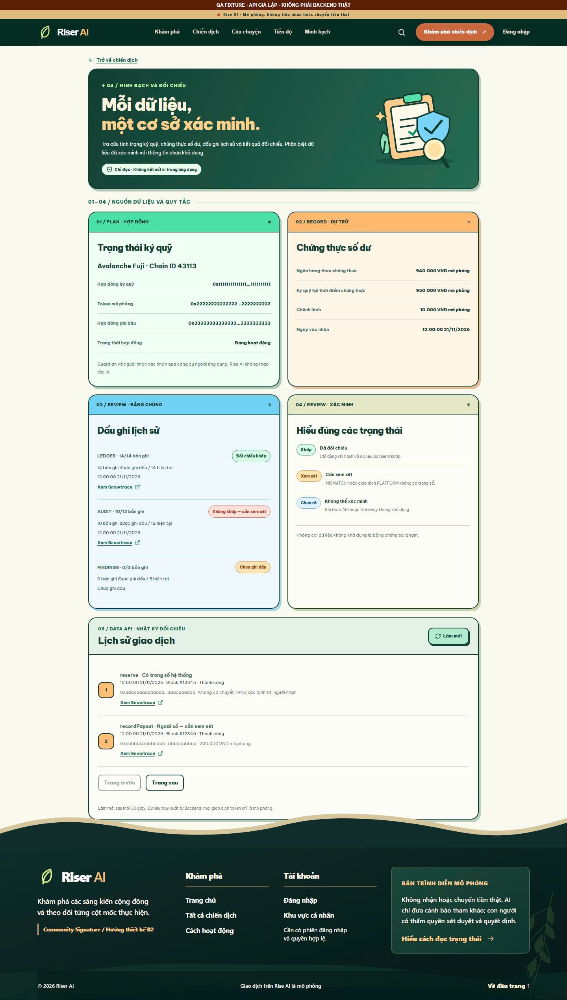
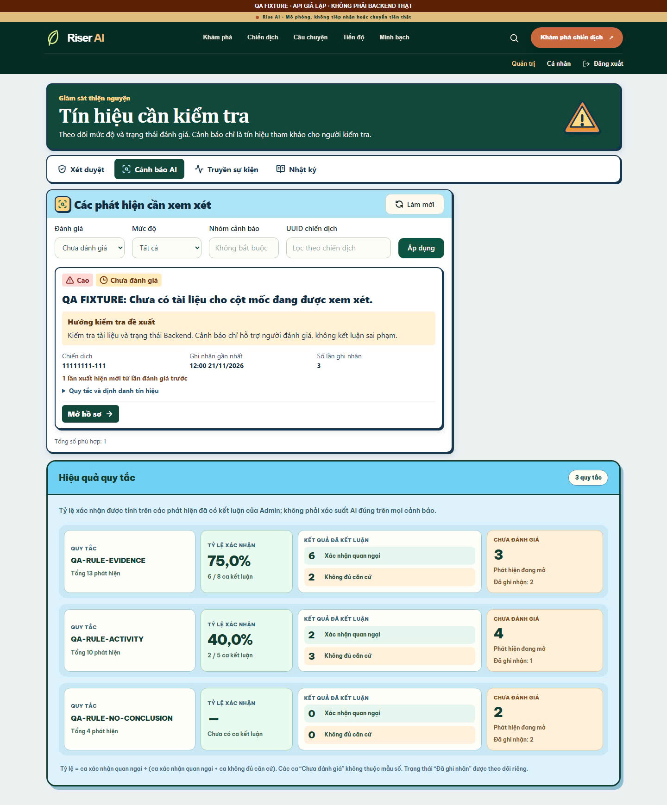

# Rise AI

**Gây quỹ từ thiện theo cột mốc, nơi luật giải ngân do contract trên Avalanche tự thực thi, kể cả với chính nền tảng.**

Luồng chính: người quyên góp đóng góp → Admin xác nhận → người tạo chiến dịch nộp minh chứng → Admin duyệt và ra lệnh giải ngân → **cửa sổ phản đối công khai trên chain** → contract chuyển rVND tới người thụ hưởng cố định → người thụ hưởng tự xác nhận đã nhận.

> Đây là môi trường **mô phỏng**: không có tiền thật. rVND là token biên nhận mô phỏng (1 đơn vị = 0,01 VND). Chỉ chạy trên Anvil cục bộ (chain 31337) hoặc Avalanche Fuji testnet (43113); mainnet bị từ chối. Giám sát AI chỉ cảnh báo, không bao giờ duyệt, chặn hay giải ngân.

## Ba điểm khác biệt

1. **Nền tảng không thể tự ý giải ngân.** Contract đòi minh chứng đã chấp thuận, ví duyệt khác ví đề nghị, chờ hết cửa sổ phản đối, và dừng khi có tranh chấp hoặc lệnh giữ: [`CampaignEscrow.sol` dòng 400–438](rise-ai-avalanche/contracts/src/CampaignEscrow.sol#L400-L438). Tiền chỉ đi tới người thụ hưởng cố định của chiến dịch ([dòng 427–437](rise-ai-avalanche/contracts/src/CampaignEscrow.sol#L427-L437)), không vượt ngân sách cột mốc ([dòng 370](rise-ai-avalanche/contracts/src/CampaignEscrow.sol#L370)).
2. **Một bên giám hộ (guardian) độc lập có quyền chặn trên chain.** Guardian đặt lệnh giữ release tối đa 14 ngày và xác nhận số dư ngân hàng; nền tảng không gỡ được lệnh giữ và không thể trở thành guardian: [`placeHold`/`liftHold`/`attestReserves` dòng 471–505](rise-ai-avalanche/contracts/src/CampaignEscrow.sol#L471-L505), [`_grantRole` dòng 702–713](rise-ai-avalanche/contracts/src/CampaignEscrow.sol#L702-L713).
3. **Kiểm chứng không cần tin nền tảng.** Sổ cái và nhật ký kiểm toán được neo dạng gốc Merkle trên [`RiseAnchor.sol`](rise-ai-avalanche/contracts/src/RiseAnchor.sol#L35); backend đối chiếu từng giao dịch của escrow với **Avalanche Data API** và gắn cờ mọi giao dịch do ví nền tảng ký mà hệ thống không ghi nhận: [`ChainActivityServiceImpl.java` dòng 100–112](rise-ai-backend/src/main/java/com/riseai/service/impl/ChainActivityServiceImpl.java#L100-L112).

## Avalanche được tận dụng thế nào

| Điểm mạnh của Avalanche | Cách Rise AI dùng |
|---|---|
| C-Chain tương thích EVM | Ba contract Solidity (`CampaignEscrow`, `RiseVND`, `RiseAnchor`) chạy nguyên trên Anvil và Fuji; ví MetaMask và Snowtrace dùng trực tiếp |
| Khối được chấp nhận là cuối cùng, nhanh | Gateway chờ 1 xác nhận rồi mới báo backend; backend chỉ chuyển đề nghị sang RELEASED sau khi `executeRelease` được xác nhận. Đo trên Fuji: trung bình **1,48 s/khối** (khối 61.054.000–61.054.100); release chạy **7 s** sau khi guardian gỡ lệnh giữ (khối 61.054.609 → 61.054.615). Cách đo: [`docs/fuji-guide.md` mục 7](docs/fuji-guide.md#7-số-đo-trong-readme-và-cách-đo-lại-đọc-2026-11-21-không-cần-khóa) |
| Phí thấp | Phí trung vị **0,00025 AVAX** mỗi giao dịch của nền tảng; 60 giao dịch của escrow v2 tốn tổng **0,01267 AVAX** (Routescan, đọc 2026-11-21, [cách đo](docs/fuji-guide.md)) |
| Explorer có verify mã nguồn | Ba contract đã verify. Mỗi giao dịch trong API `/api/v1/transparency/*` có `explorerUrl`; trên Fuji, trang `/transparency` liệt kê từng giao dịch kèm link, trang chiến dịch có link cho từng yêu cầu giải ngân, panel admin hiện 8 lệnh gần nhất. Guardian và người thụ hưởng ký từ tab "Write Contract" |
| Avalanche Data API | Nguồn độc lập để đối chiếu: RECORDED, INDEPENDENT, REVERTED, UNRECORDED ([`AvalancheDataApiClient.java`](rise-ai-backend/src/main/java/com/riseai/client/AvalancheDataApiClient.java)) |
| Event log của EVM | Contract phát event cho mọi thay đổi trạng thái; gateway quét log bằng `eth_getLogs` theo con trỏ khối ([`LogScanner.java`](rise-ai-avalanche/src/main/java/com/riseai/avalanche/scan/LogScanner.java), [`CampaignEvents.java`](rise-ai-avalanche/src/main/java/com/riseai/avalanche/contract/CampaignEvents.java)) |
| Giao dịch EIP-1559 trên C-Chain | Gateway tự ký bằng keystore, cấp nonce theo từng ví, theo dõi trạng thái và gửi lại giao dịch kẹt với phí cao hơn ([`SubmissionService.java`](rise-ai-avalanche/src/main/java/com/riseai/avalanche/tx/SubmissionService.java), [`NonceAllocator.java`](rise-ai-avalanche/src/main/java/com/riseai/avalanche/tx/NonceAllocator.java), [`TxTracker.java`](rise-ai-avalanche/src/main/java/com/riseai/avalanche/tx/TxTracker.java)) |
| Chỉ chạy đúng mạng | Từ chối chain 1, 43114 và URL chứa "mainnet" ở gateway ([`EnvironmentGuard.java` dòng 14](rise-ai-avalanche/src/main/java/com/riseai/avalanche/env/EnvironmentGuard.java#L14)) và ở script deploy ([`Deploy.s.sol` dòng 34](rise-ai-avalanche/contracts/script/Deploy.s.sol#L34)); manifest phải khớp chain id và chỉ nhận rVND 2 chữ số thập phân, từ chối USDC ([`ManifestVerifier.java` dòng 30](rise-ai-avalanche/src/main/java/com/riseai/avalanche/contract/ManifestVerifier.java#L30)) |
| Testnet Fuji | Chạy end-to-end, tranh chấp, guardian và neo Merkle trên mạng thật |

**Triển khai trên Fuji (contract version 2, 2026-11-14), cả ba đã verify mã nguồn:**

| Contract | Địa chỉ | Tx triển khai |
|---|---|---|
| CampaignEscrow | [`0x183600b4392E2344df90e8d24b9e925832E32031`](https://testnet.snowtrace.io/address/0x183600b4392E2344df90e8d24b9e925832E32031) | [`0xa5288dea…f65e`](https://testnet.snowtrace.io/tx/0xa5288dea5448e2c2527ed15cebbcb2ec282bf66a661c2190dc5a2f3b2cc8f65e) |
| RiseVND (rVND) | [`0x4Fd2ba7be8DfE084b5b8A78f67f45F781e40e80A`](https://testnet.snowtrace.io/address/0x4Fd2ba7be8DfE084b5b8A78f67f45F781e40e80A) | [`0x17e33407…ba28`](https://testnet.snowtrace.io/tx/0x17e334079616683c7c0cb24095fa6461573458bd119a15458097aac3c369ba28) |
| RiseAnchor | [`0x57C043B4830EfFF02A752476d77Ce45A21c14f4f`](https://testnet.snowtrace.io/address/0x57C043B4830EfFF02A752476d77Ce45A21c14f4f) | [`0x1654e8c7…ec4b`](https://testnet.snowtrace.io/tx/0x1654e8c7a0acdde29b1d0d8a429a1185b733ebf7559965c89519a1e79726ec4b) |

Tính tới 2026-11-21, escrow v2 có 60 giao dịch từ 5 ví (49 thành công, 11 bị contract từ chối đúng luật). Một số giao dịch tiêu biểu:

| Bước | Ai ký | Giao dịch |
|---|---|---|
| Ra lệnh giải ngân, mở cửa sổ phản đối | Approver (nền tảng) | [0x3368…927a](https://testnet.snowtrace.io/tx/0x336856f6c868cd2465bbac40c62b24ae724d8942d8b4bfeb62daf683d706927a) |
| Guardian đặt lệnh giữ | Guardian (MetaMask) | [0x3d7a…6deb](https://testnet.snowtrace.io/tx/0x3d7af22aac6d0234df7c4806a50261ebafb2d50529c20ab64bc100860236fdeb) |
| Giải ngân bị contract từ chối: `MilestoneHeld()` | Relayer (nền tảng) | [0x15aa…a303](https://testnet.snowtrace.io/tx/0x15aac4db30fb266703d52efaaa36aff3a484209a675764c613a8e7214e00a303) |
| Guardian gỡ lệnh giữ | Guardian | [0xd4b9…c0f0](https://testnet.snowtrace.io/tx/0xd4b95716d2f5e40c421f1447127b3676999e5757f606131359d507c6e842c0f0) |
| Giải ngân thành công | Relayer | [0x69e5…5da2](https://testnet.snowtrace.io/tx/0x69e54ef0269b430a55661667abc531fe80e1be2eebc63cc30bfd075c19f75da2) |
| Guardian xác nhận dự trữ: ngân hàng 135.000.000 = đang giữ 135.000.000 VND | Guardian | [0x42c9…3e68](https://testnet.snowtrace.io/tx/0x42c94e1b11c52acc24436b048b6546fa073eb660601148c4085557acb1a03e68) |
| Người thụ hưởng xác nhận đã nhận | Người thụ hưởng (MetaMask) | [0xbe08…78d8](https://testnet.snowtrace.io/tx/0xbe08d1fa3cdc3747e1c0eed2fff9f2531496eda512b13efc3817e711197378d8) |

Lịch sử đầy đủ, gồm lượt chạy tranh chấp trên contract version 1 (giải ngân bị chặn bởi `MilestoneDisputed()`), ở [`rise-ai-avalanche/README.md`](rise-ai-avalanche/README.md#fuji-guardian-run-contract-version-2-2026-11-14).

Tự kiểm tra bản triển khai, không cần khóa (chỉ đọc chain, cần Docker):

```bash
cd rise-ai-avalanche/contracts && bash scripts/forge.sh "sh scripts/verify-fuji.sh"   # mong đợi: ALL CHECKS PASSED
```

## Luồng chạy và những gì được ghi lên chain

```
1. Người quyên góp gửi đóng góp (PENDING)
2. Admin xác nhận                          → recordContribution
3. Người tạo nộp minh chứng kèm SHA-256     → anchorEvidence (hash tệp do người tạo khai)
4. Người tạo gửi đề nghị giải ngân          → reserve (giữ chỗ tiền, không vượt ngân sách cột mốc)
5. Admin chấp thuận minh chứng              → decideEvidence;  Admin phê duyệt đề nghị
6. Admin ra lệnh giải ngân                  → queueRelease (mở cửa sổ phản đối)
      trong cửa sổ: người quyên góp mở tranh chấp → contract chặn (MilestoneDisputed)
                    guardian đặt lệnh giữ          → contract chặn (MilestoneHeld)
7. Hết cửa sổ, không bị chặn                → executeRelease → rVND tới người thụ hưởng
                                            → recordPayout;  người thụ hưởng tự ký confirmReceipt
Song song, không ảnh hưởng tiền:
   mỗi hành động → outbox → dịch vụ giám sát → phát hiện (finding) → Admin xem xét
   định kỳ: gốc Merkle của sổ cái, nhật ký kiểm toán và lịch sử phát hiện → RiseAnchor.anchor
```

Admin là người duyệt minh chứng và giải ngân. Người quyên góp không bỏ phiếu duyệt cột mốc; quyền của họ là chặn: mở tranh chấp trong cửa sổ phản đối thì contract không cho giải ngân. AI không ký giao dịch, không duyệt và không chặn tiền.

| Dữ liệu ghi lên chain | Trong mã | Trên Fuji, contract version 2 (đọc on-chain 2026-11-21) |
|---|---|---|
| Đóng góp, giữ chỗ, giải ngân, payout, xác nhận nhận tiền | [`ChainCommandRecorder.java`](rise-ai-backend/src/main/java/com/riseai/service/impl/ChainCommandRecorder.java), [`AvalancheEscrowEngine.java`](rise-ai-backend/src/main/java/com/riseai/service/impl/AvalancheEscrowEngine.java) | Có: `recordContribution` 12, `reserve` 4, `queueRelease` 3, `executeRelease` 12 (gồm các lần bị chặn), `recordPayout` 2, `confirmReceipt` 1 |
| Hash minh chứng của người tạo (`anchorEvidence`) và quyết định duyệt (`decideEvidence`) | [`ChainCommandRecorder.java` dòng 41–50](rise-ai-backend/src/main/java/com/riseai/service/impl/ChainCommandRecorder.java#L41-L50) | Có: 5 và 5 lần |
| Tranh chấp, lệnh giữ và xác nhận dự trữ của guardian | `openDispute`, `placeHold`, `liftHold`, `attestReserves` | Có: 1, 2, 1, 1 lần |
| Gốc Merkle sổ cái (LEDGER) và nhật ký kiểm toán (AUDIT) | [`AnchorRecords.java`](rise-ai-backend/src/main/java/com/riseai/service/impl/AnchorRecords.java#L27-L32), [`ChainAnchorRelay.java`](rise-ai-backend/src/main/java/com/riseai/service/impl/ChainAnchorRelay.java) | Có: LEDGER 4 lần, AUDIT 6 lần |
| Gốc Merkle lịch sử phát hiện giám sát AI (FINDINGS): mã finding, sự kiện nguồn, người liên quan, mức độ, thời gian của mỗi lần phát hiện | [`AnchorRecords.java` dòng 33–34](rise-ai-backend/src/main/java/com/riseai/service/impl/AnchorRecords.java#L33-L34) | **Chưa**: 0 lần. Relay bỏ qua khi bảng còn trống ([dòng 70](rise-ai-backend/src/main/java/com/riseai/service/impl/ChainAnchorRelay.java#L70)) |
| Nội dung do AI viết (ghi chú AI, lời giải thích của phát hiện) | Không đưa vào hash | Không |

Số lần gọi lấy từ danh sách giao dịch của escrow và anchor v2 trên Routescan; số lần neo từ `anchorCount` (chạy `verify-fuji.sh`).

## Chức năng

- **Người quyên góp:** xem chiến dịch, ghi nhận đóng góp mô phỏng, hủy khi còn chờ, yêu cầu hoàn tiền, mở và theo dõi phản ánh/tranh chấp.
- **Người tạo chiến dịch:** tổ chức, chiến dịch và cột mốc (tổng ngân sách bằng mục tiêu), nộp minh chứng kèm SHA-256, đề nghị giải ngân.
- **Admin:** xác minh tổ chức, duyệt chiến dịch, xác nhận đóng góp, duyệt minh chứng và giải ngân, xử lý tranh chấp, hoàn tiền, tất toán pro-rata và điều chỉnh sổ cần hai người, đối soát, xem phát hiện giám sát và nhật ký kiểm toán.
- **Minh bạch công khai** (`/transparency`, khi chạy trên Fuji): hợp đồng và mạng, guardian, bằng chứng dự trữ, trạng thái neo Merkle, hoạt động on-chain lấy từ Avalanche Data API, link Snowtrace cho từng giao dịch.
- **Giám sát AI:** 8 luật tất định cho hoạt động từ thiện (ví dụ minh chứng trùng hash, đề nghị lặp nhiều lần), mỗi phát hiện có giải thích và cần con người xem xét; phân tích bằng mô hình Ollama cục bộ là tùy chọn.

## Kiến trúc

```
 Trình duyệt (React) ──/api/v1──▶ rise-ai-backend ──outbox──▶ rise-ai-monitoring ──▶ phát hiện ──▶ Admin xem xét
                                    │      │
                                    │      └──chain_commands──▶ rise-ai-avalanche (gateway) ──JSON-RPC──▶ Avalanche C-Chain
                                    │                                                         CampaignEscrow · RiseVND · RiseAnchor
                                    └──────── Avalanche Data API (đối chiếu độc lập) ◀──────────────────────┘
```

Backend sở hữu mọi quyết định nghiệp vụ và sổ cái. Lệnh ghi chain đi qua bảng outbox `chain_commands`, nên lỗi mạng không làm mất giao dịch nghiệp vụ. Gateway giữ khóa ký, cấp nonce, theo dõi và thay thế giao dịch kẹt. Trình duyệt không bao giờ gọi gateway, RPC hay dịch vụ giám sát. Ba dịch vụ Java không chia sẻ mã hay cơ sở dữ liệu.

| Module | Vai trò | Công nghệ | Tài liệu |
|---|---|---|---|
| [`rise-ai-backend/`](rise-ai-backend/README.md) | Người dùng, tổ chức, chiến dịch, cột mốc, minh chứng, đóng góp, hoàn tiền, ký quỹ và sổ cái append-only, giải ngân, tranh chấp, tất toán, điều chỉnh, kiểm toán, `/transparency` | Spring Boot 3.3.5, Java 21, MySQL 8.4, Flyway | [`docs/`](rise-ai-backend/docs/README.md) |
| [`rise-ai-avalanche/`](rise-ai-avalanche/README.md) | Gateway chain (cổng 8082) và contract Foundry | Spring Boot 3.5.16, web3j 6.1.0; Solidity 0.8.38, OpenZeppelin 5.7.0 | [`README`](rise-ai-avalanche/README.md) |
| [`rise-ai-monitoring/`](rise-ai-monitoring/README.md) | Kiểm tra sự kiện, luật tất định, phát hiện có giải thích | Spring Boot 3.5.15, Java 21, H2 | [`docs/`](rise-ai-monitoring/docs/README.md) |
| [`rise-ai-frontend/`](rise-ai-frontend/README.md) | Giao diện cho người quyên góp, người tạo chiến dịch, admin và trang công khai | React 19, Vite 6, TypeScript 5, Tailwind CSS 4 | [`PROGRESS`](rise-ai-frontend/docs/PROGRESS.md) |

## Kiểm thử

Các lần chạy ngày 2026-11-21 dùng image Docker `maven:3.9-eclipse-temurin-21` và `ghcr.io/foundry-rs/foundry:v1.8.7`; mọi bộ test cũng chạy trên CI ở mỗi pull request ([`ci.yml`](.github/workflows/ci.yml)).

| Bộ test | Lệnh | Kết quả | Evidence |
|---|---|---|---|
| Contract (unit, fuzz 256 lần, 7 bất biến) | `cd rise-ai-avalanche/contracts && bash scripts/install-deps.sh && bash scripts/forge.sh "forge test --summary"` | 93 pass, 0 fail, 0 skip (2026-11-21) | [`contracts/test/`](rise-ai-avalanche/contracts/test), [bất biến](rise-ai-avalanche/contracts/test/CampaignEscrowInvariants.t.sol) |
| Bản triển khai Fuji (chỉ đọc) | `bash scripts/forge.sh "sh scripts/verify-fuji.sh"` | 14/14 PASS (2026-11-21) | [`verify-fuji.sh`](rise-ai-avalanche/contracts/scripts/verify-fuji.sh) |
| Gateway (Anvil và MySQL thật qua Testcontainers) | xem [`rise-ai-avalanche/README.md`](rise-ai-avalanche/README.md#run-the-tests) | 118 chạy, 0 lỗi, 3 bỏ qua có chủ đích (2026-11-21) | [`ci.yml`](.github/workflows/ci.yml) |
| Backend (MySQL thật qua Testcontainers, kiểm thử thuộc tính jqwik, kiểm thử đồng thời) | `cd rise-ai-backend && mvn clean test` | 204 chạy, 0 lỗi, 0 bỏ qua (2026-11-21) | [`testing-strategy.md`](rise-ai-backend/docs/testing-strategy.md) |
| Giám sát | `cd rise-ai-monitoring && ./mvnw clean test` | 223 chạy, 0 lỗi, 0 bỏ qua (2026-11-21); simulator 2.000/2.000 kịch bản | [`TESTING.md`](rise-ai-monitoring/docs/TESTING.md) |
| Frontend (kiến trúc, hợp đồng API, lint, typecheck, test, build) | `cd rise-ai-frontend && npm ci && npm run verify` | PASS: 37/37 test, hợp đồng API 116 path, lint, typecheck, build (2026-11-21, image `node:22`); chạy trên CI (workflow "Frontend checks") | [`frontend-ci.yml`](.github/workflows/frontend-ci.yml) |
| E2E trình duyệt + API trên stack Docker (engine `simulated`, Playwright Chromium 1440×900): công khai, RBAC/IDOR, người tạo → admin → người quyên góp, hoàn tiền, giải ngân, tranh chấp, đối soát, finding giám sát | [`qa/docker-e2e/e2e.mjs`](qa/docker-e2e/README.md) và `supplement.mjs` | 61/61 và 3/3 PASS, 0 phản hồi 5xx (2026-11-21) | [`qa/docker-e2e/README.md`](qa/docker-e2e/README.md) |
| Đối chiếu MySQL sau E2E (chỉ `SELECT`), gồm đẳng thức số dư ký quỹ | `python qa/docker-e2e/db-verify.py <thư mục kết quả>` | 14/14 PASS (2026-11-21) | [`db-verify.py`](qa/docker-e2e/db-verify.py) |
| Fuji end-to-end, tranh chấp, guardian, neo Merkle | thủ công trên Fuji | giao dịch ở mục Avalanche | [`rise-ai-avalanche/README.md`](rise-ai-avalanche/README.md#fuji-runbook-testnet-only-adr-009) |

## Dành cho ban giám khảo

### Đọc gì trước

1. Mục "Avalanche được tận dụng thế nào" ở trên, rồi mở contract escrow trên Snowtrace.
2. [`CampaignEscrow.sol`](rise-ai-avalanche/contracts/src/CampaignEscrow.sol) (721 dòng) và [bất biến](rise-ai-avalanche/contracts/test/CampaignEscrowInvariants.t.sol).
3. [`rise-ai-avalanche/README.md`](rise-ai-avalanche/README.md): mô hình tin cậy, những gì chain bảo đảm và không bảo đảm.
4. [`docs/fuji-guide.md`](docs/fuji-guide.md): kiểm tra, triển khai lại, verify, smoke test trên Fuji.

### Khởi chạy bằng một lệnh

Yêu cầu: Docker có Compose v2.17 trở lên. Lần build đầu mất vài phút (tải Maven, npm, Solidity). Chạy test ngoài Docker thì cần thêm JDK 21 và Maven 3.9+ (backend không có Maven wrapper) và Node 22.12 trở lên.

```bash
cp .env.example .env     # rồi đổi mọi giá trị; .env không được commit
docker compose -p rise-ai up -d --build
```

Stack này dùng **chain Anvil cục bộ** (31337) với khóa dùng một lần do gateway tự sinh; không cần ví hay coin.

| Dịch vụ | Cổng trên máy | Ghi chú |
|---|---|---|
| Giao diện | http://127.0.0.1:5174 | Nginx, `/api` chuyển tới backend |
| Backend | http://127.0.0.1:8080 | Chạy profile `prod`, nên Swagger tắt; Swagger `/swagger-ui.html` chỉ có khi chạy backend ở chế độ phát triển |
| Gateway Avalanche | http://127.0.0.1:8082 | |
| Anvil | http://127.0.0.1:8545 | chain 31337 |
| MySQL, giám sát | không mở ra ngoài | |

Dấu hiệu sẵn sàng:

```bash
docker compose -p rise-ai ps -a      # các dịch vụ chạy một lần (avalanche-contracts, avalanche-bootstrap, avalanche-db-init) phải là "Exited (0)"
curl -s http://127.0.0.1:5174/api/v1/transparency/chain     # có "onChain": true và "network": "LOCAL_SIMULATION"
```

Sau khi khởi động, các lệnh chain của dữ liệu mẫu mất vài phút để được xác nhận. Dừng: `docker compose -p rise-ai down` (giữ dữ liệu) hoặc `docker compose -p rise-ai down -v` (xóa dữ liệu của project này; MySQL và Anvil luôn phải xóa cùng nhau). Chi tiết: [`docs/local-docker-stack.md`](docs/local-docker-stack.md).

### Tài khoản demo

Có trong dữ liệu mẫu khi `RISE_SEED_ENABLED=true` (mặc định trong `.env.example`). Mật khẩu là giá trị `RISE_DEMO_PASSWORD` bạn đặt trong `.env`; khi chạy backend ở chế độ phát triển (không Docker), mật khẩu mặc định ghi trong [`demo-credentials.md`](rise-ai-backend/docs/demo-credentials.md).

| Email | Vai trò |
|---|---|
| `admin@riseai.example` | Admin |
| `donor1@riseai.example`, `donor2@…`, `donor3@…` | Người quyên góp |
| `creator1@riseai.example`, `creator2@…`, `creator3@…` | Người tạo chiến dịch |
| `suspended.donor@riseai.example` | Bị khóa (đăng nhập bị từ chối) |

### Chuẩn bị ví

- **Stack Docker cục bộ:** không cần ví.
- **Kiểm tra Fuji:** chỉ cần trình duyệt (Snowtrace) hoặc `verify-fuji.sh`.
- **Tài khoản trong app không gắn với ví.** Người quyên góp, người tạo và Admin không cần ví; ví người thụ hưởng là một địa chỉ cấu hình (`RISE_AVALANCHE_BENEFICIARY_ADDRESS`), guardian là một ví độc lập được ghi vào contract lúc deploy.
- **Tự ký trên Fuji** (vai trò guardian hoặc người thụ hưởng): thêm mạng Fuji vào Core hoặc MetaMask (RPC `https://api.avax-test.network/ext/bc/C/rpc`, chain id 43113, ký hiệu AVAX, explorer `https://testnet.snowtrace.io`), nhận AVAX testnet từ faucet của Avalanche (`https://core.app/tools/testnet-faucet/`, chọn C-Chain; điều kiện nhận do faucet đặt). Không cần USDC: escrow chỉ giữ rVND mô phỏng, do script deploy mint vào treasury. Hướng dẫn: [`docs/fuji-guide.md`](docs/fuji-guide.md).

### Kịch bản end-to-end (stack Docker, dữ liệu mẫu)

Chiến dịch dùng: **"Hope Kitchen Weekly Meals (Demo)"** của `creator3`, đang ACTIVE, đã có 22.000.000 VND sau hoàn tiền, cột mốc 1 có ngân sách 20.000.000 VND. Mỗi thao tác của Admin mở một biểu mẫu: tích ô xác nhận rồi bấm **"Xác nhận thao tác"**.

| # | Ai | Làm gì, bấm nút nào | Phải thấy gì |
|---|---|---|---|
| 1 | Khách | Mở `/campaigns`, chọn chiến dịch | Trang chi tiết có khối "Minh bạch & Xác thực" với trạng thái mở chiến dịch trên chain và các yêu cầu giải ngân (tự làm mới mỗi 30 giây) |
| 2 | `donor1` | `/login` → **"Đăng nhập"**; trên trang chiến dịch bấm **"Ghi nhận đóng góp mô phỏng"**, nhập số tiền, tích ô xác nhận, bấm **"Gửi yêu cầu mô phỏng"** | Đóng góp ở trạng thái PENDING trong `/donor` |
| 3 | `admin` | `/admin` → hàng đợi **"Đóng góp"** → **"Xem và xử lý"** → **"Xác nhận đóng góp mô phỏng"** | Đóng góp CONFIRMED; backend xếp lệnh `recordContribution` lên chain |
| 4 | `creator3` | `/creator` → **"Quản lý"** ở chiến dịch → **"Minh chứng & giải ngân"** ở cột mốc 1 → **"Bắt đầu"** (xác nhận hộp thoại) → **"Gửi minh chứng"**, điền và gửi | Minh chứng SUBMITTED; lệnh `anchorEvidence` (hash minh chứng) |
| 5 | `creator3` | **"Đề nghị giải ngân"** → nhập số tiền ≤ 20.000.000 → **"Gửi đề nghị (không chuyển tiền)"** | Đề nghị SUBMITTED; tiền được giữ chỗ, lệnh `reserve` |
| 6 | `admin` | `/admin` → hàng đợi **"Giải ngân"** → **"Xem và xử lý"** → **"Bắt đầu xét duyệt"**; ở phần minh chứng bấm **"Chấp thuận minh chứng"**; rồi **"Phê duyệt đề nghị"** | Minh chứng ACCEPTED (lệnh `decideEvidence`); đề nghị APPROVED |
| 7 | `admin` | **"Ghi sổ giải ngân mô phỏng"** | Đề nghị vẫn APPROVED; khối "Minh bạch & Xác thực" và `/admin/escrow` ("Lệnh và thời gian chờ on-chain") hiện "Đang trong cửa sổ phản đối" với đồng hồ đếm ngược; lệnh `queueRelease` |
| 8 | Hệ thống | Chờ hết cửa sổ phản đối (`RISE_AVALANCHE_RELEASE_DELAY`, mặc định 2 phút) | Gateway gửi `executeRelease`; trạng thái "Đã giải ngân on-chain", đề nghị chuyển RELEASED |
| 9 | Bất kỳ ai | `curl -s http://127.0.0.1:5174/api/v1/transparency/campaigns/<campaignId>` | Danh sách lệnh chain của chiến dịch với tx hash và trạng thái |

Trên stack cục bộ (Anvil 31337), giao diện cố ý không giả dữ liệu Fuji: huy hiệu hiện "Chưa xác minh trạng thái ký quỹ", trang `/transparency` hiện "Chưa thể công bố dữ liệu Fuji", và link Snowtrace không mở được. Huy hiệu "Ký quỹ on-chain · Avalanche Fuji", các mục dự trữ, neo Merkle và hoạt động từ Avalanche Data API chỉ hiện khi backend chạy với gateway Fuji ([`docs/fuji-guide.md`](docs/fuji-guide.md) mục 5).

Nhánh phụ:

- **Tranh chấp chặn giải ngân:** ngay sau bước 7, trong cửa sổ phản đối (mặc định chỉ 2 phút; muốn thong thả thì đặt `RISE_AVALANCHE_RELEASE_DELAY=PT10M` trong `.env`), `donor1` mở phản ánh trên `/donor` (**"Gửi phản ánh"**); backend giữ đề nghị ở trạng thái tranh chấp và contract từ chối release (`MilestoneDisputed`). Admin vào hàng đợi **"Tranh chấp"** → **"Nhận xử lý phản ánh"** → **"Bác bỏ phản ánh"** hoặc **"Chấp nhận phản ánh"**.
- **Hoàn tiền:** `donor1` bấm **"Yêu cầu hoàn tiền"** → **"Gửi yêu cầu hoàn tiền"**; Admin ở hàng đợi **"Hoàn tiền"**: **"Chấp thuận hoàn tiền mô phỏng"** → **"Ghi sổ hoàn tiền mô phỏng"**.
- **Từ chối:** Admin có **"Từ chối minh chứng"**, **"Yêu cầu thêm minh chứng"**, **"Từ chối đề nghị"**.
- **Giám sát:** `/admin/monitoring` liệt kê các phát hiện; mỗi phát hiện cần ghi chú khi xem xét.
- **Guardian trên Fuji:** [`docs/fuji-guide.md`](docs/fuji-guide.md) mục 5.

### Kiểm thử tự động

```bash
# luồng ký quỹ đầy đủ và engine Avalanche với MySQL thật (cần Docker)
cd rise-ai-backend && mvn test -Dtest='EscrowLifecycleIntegrationTest,AvalancheEscrowEngineIntegrationTest,TransparencyIntegrationTest'
# kiểm tra Nginx, API cùng origin và route SPA trên stack Docker đang chạy
cd rise-ai-frontend && RISE_FE06_BASE_URL=http://127.0.0.1:5174 RISE_FE06_TARGET=docker npm run deploy:smoke
```

Toàn bộ luồng đóng góp → giải ngân qua giao diện thật được kiểm tự động bằng [`qa/docker-e2e`](qa/docker-e2e/README.md) (61/61, engine `simulated`, không gửi giao dịch lên chain). Với engine `avalanche`, luồng này được kiểm bằng test tích hợp backend và lượt chạy thủ công trên Fuji (gần nhất 2026-11-14).

## Lộ trình

- **Ví trong ứng dụng:** để người quyên góp ký trực tiếp, kèm EIP-2612/EIP-3009 và một relayer trả gas, thay cho việc backend chuyển tiếp.
- **Khóa cấp production:** KMS/HSM và multisig cho approver, thay keystore testnet.
- **Kiểm toán contract độc lập** và phân tích tĩnh (Slither) trước khi có người dùng thật.
- **Neo lịch sử phát hiện giám sát trên Fuji:** chạy một lượt có dịch vụ giám sát bật để `FINDINGS` có lần neo đầu tiên; sau đó đưa cả nội dung do AI viết vào hash bằng một loại neo mới, để không làm sai các gốc đã neo.
- **Người quyên góp tham gia duyệt cột mốc**, bên cạnh quyền mở tranh chấp hiện có (cần sửa contract và triển khai lại).
- **Hiệu chỉnh phí gas** của gateway theo số đo trên Fuji ([`docs/fuji-guide.md`](docs/fuji-guide.md) mục 6).
- **Bản demo công khai** trên Fuji cho ban giám khảo tự thao tác.
- **Avalanche L1 cho mạng từ thiện**, với các tổ chức kiểm toán làm validator; ICM để nối nhiều nền tảng.
- **Đăng nhập hai lớp cho Admin** và chính sách lưu trữ dữ liệu ([`docs/decisions-pending.md`](docs/decisions-pending.md)).

## Ảnh giao diện

> Ảnh chụp từ giao diện React thật ở độ rộng desktop, nhưng dùng **dữ liệu QA giả lập** (dải "QA FIXTURE · API GIẢ LẬP" trên đầu mỗi ảnh). Địa chỉ contract, số block và tx hash trong ảnh là giá trị mẫu, không phải dữ liệu Fuji; dữ liệu Fuji thật nằm ở mục "Avalanche được tận dụng thế nào".

**Trang chủ:** lĩnh vực, chiến dịch đang kêu gọi, tiến độ theo cột mốc và giải thích quy trình đối chiếu.

<div align="center">



</div>

**Chi tiết chiến dịch:** tiến độ gây quỹ, hành trình theo cột mốc, khối "Minh bạch & Xác thực" với trạng thái từng yêu cầu giải ngân trên chain: đang trong cửa sổ phản đối (đếm ngược), tạm dừng bởi guardian, đã giải ngân và người nhận đã xác nhận, kèm link Snowtrace.

<div align="center">



</div>

**Người quyên góp:** lịch sử đóng góp với trạng thái (chờ xác nhận, đã xác nhận, hoàn tiền, bị hủy), biên nhận từng khoản và nút yêu cầu hoàn tiền.

<div align="center">



</div>

**Đối chiếu on-chain** (`/transparency`): trạng thái ký quỹ trên Fuji, chứng thực số dư của guardian, dấu ghi Merkle của LEDGER / AUDIT / FINDINGS với kết quả khớp hoặc không khớp, và lịch sử giao dịch lấy từ Avalanche Data API.

<div align="center">



</div>

**Admin: cảnh báo AI:** các phát hiện cần xem xét kèm hướng kiểm tra, và tỷ lệ xác nhận của từng quy tắc dựa trên kết luận của Admin. Cảnh báo chỉ để tham khảo, không tự ra quyết định.

<div align="center">



</div>

## Tài liệu

- [`docs/INDEX.md`](docs/INDEX.md): mục lục toàn repo.
- [`docs/fuji-guide.md`](docs/fuji-guide.md): Fuji, triển khai, verify, smoke test.
- [`rise-ai-avalanche/README.md`](rise-ai-avalanche/README.md): gateway, contract, mô hình tin cậy, các lượt chạy Fuji.
- [`docs/local-docker-stack.md`](docs/local-docker-stack.md): chạy toàn bộ ứng dụng bằng Docker.
- [`qa/docker-e2e/README.md`](qa/docker-e2e/README.md): bộ E2E trình duyệt + API và đối chiếu MySQL, chạy lại được.
- [`docs/handoff-2026-11-21.md`](docs/handoff-2026-11-21.md): bàn giao: đã làm gì, chạy được gì, vấn đề đã biết, việc tiếp theo.
- [`rise-ai-backend/docs/README.md`](rise-ai-backend/docs/README.md): kiến trúc, quy tắc nghiệp vụ, máy trạng thái, API, bảo mật.
- [`docs/ai-monitoring/README.md`](docs/ai-monitoring/README.md): giám sát AI.
- [`docs/decisions-pending.md`](docs/decisions-pending.md): các quyết định đang chờ chủ dự án.
