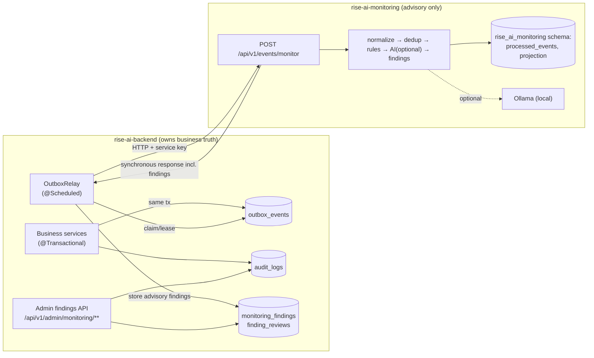

# 02 — Architecture and Integration Design

Labels as defined in [README.md](README.md). **Implemented 2026-10-25** (see [06-progress-report.md](06-progress-report.md)). §1 describes the pre-implementation state, so read `rise-ai-monitoring/` and `com.riseai.monitoring` for the old `local-ai-event-monitor` paths. Backend class paths throughout this document (for example `outbox/…`, `finding/…`, `security/JwtService.java`, `common/CorrelationIdFilter.java`) use the capability layout that existed before the layered refactor; current locations are in `rise-ai-backend/docs/architecture.md` (ADR-008). Canonical as-built references: `rise-ai-backend/docs/event-contracts.md`, `rise-ai-backend/docs/decisions/ADR-007-monitoring-integration.md`, `rise-ai-monitoring/docs/ARCHITECTURE.md`.

As-built differences from this design:
- Projection store is embedded H2, not a MySQL schema.
- No durable deduplication.
- Retry policy is max-attempts only, without a retry horizon.
- The service key is sent as `Authorization: Bearer`.
- Backend outbox metrics are exposed through `GET /api/v1/admin/monitoring/outbox/stats` instead of actuator metrics.
- No shared `contracts/` folder.
- The configuration keys in §10 differ slightly: `retry-horizon` was dropped and `initial-backoff`, `max-backoff` and `published-retention` were added (see the backend README).

## 1. Verified current state

### 1.1 Backend (`rise-ai-backend/`) — VERIFIED

- Modular monolith: Spring Boot 3.3.5, Java 21, MySQL 8.4, Flyway V1–V7, JPA with `ddl-auto: validate`.
- Auth: stateless JWT signed with an **HMAC shared secret** (`security/JwtService.java` uses `MACSigner` / `MACVerifier`; secret `rise.security.jwt.secret`). Roles `ADMIN`, `DONOR`, `CAMPAIGN_CREATOR` (`user/Role.java`). `/api/v1/admin/**` requires ADMIN (`security/SecurityConfig.java`).
- Correlation: `common/CorrelationIdFilter.java` accepts `X-Correlation-Id` matching `^[A-Za-z0-9._-]{1,64}$`, otherwise generates a UUID; stored in MDC key `correlationId`.
- Traceability: `audit/AuditService.record(...)` and `transition(...)` write `audit_logs` and `status_history` in the caller's transaction (`@Transactional`, default `REQUIRED`). Every business action has an action string (about 70). `git grep -hoE '"[A-Z]+_[A-Z_]+"' rise-ai-backend/src/main/java | sort -u` lists them; it printed 84 lines at `aaf374e` because it also matches non-action constants such as entity type names (`"ESCROW_ACCOUNT"`).
- **No event publication of any kind.** No `ApplicationEventPublisher`, `@EventListener`, `@TransactionalEventListener`, outbox, broker client, `RestClient`, `WebClient`, `RestTemplate` or `HttpClient` in `src/main`.
- Scheduling exists: `config/ScheduledJobs.java` (`@EnableScheduling`, gated by `rise.jobs.enabled`) runs reconciliation hourly and fundraising close every 5 minutes.
- Designed but not emitted: `docs/event-contracts.md` (envelope v1 + 13 event types), `docs/decisions/ADR-004-ai-event-boundary.md`, `docs/phase-2-ai-monitoring.md`.

### 1.2 Monitor (`local-ai-event-monitor/`) — VERIFIED

- Spring Boot 3.5.15, Java 21, no database, no authentication, no outbound calls except Ollama `/api/chat` and `/api/tags`.
- Pipeline in `service/impl/EventMonitoringServiceImpl.java`: `EventNormalizer` → `InMemoryEventDeduplicator` (key `source + eventId`, SHA-256 fingerprint of eventType, source, occurredAt, severity, attributes, payload; 24 h retention; 10 000 entries) → `RuleEngine` (6 generic rules) → `AiEventAnalyzer` (only implementation `OllamaEventAnalyzer`) → `MonitoringResultAssembler` → `MonitoringResultPublisher` beans (only `LoggingMonitoringResultPublisher`).
- Invariants enforced in code and tests: risk level comes **only** from rule findings; AI failure never lowers risk; startup makes no network calls; Ollama is not a health contributor; the prompt excludes `eventId` and `correlationId`; payload is excluded from the prompt by default (`monitoring.ai.include-payload: false`); field names containing `password`, `secret`, `token`, `authorization`, `apikey` or `credential` are redacted.
- Extension points: `MonitoringRule` (list), `AiEventAnalyzer` (single), `EventDeduplicator` (single), `MonitoringResultPublisher` (list).
- Test fakes exist: `testsupport/FakeAiEventAnalyzer`, `StubOllamaServer`, `MutableClock`, `RecordingResultPublisher`, `TestEvents`.
- DOC-ONLY: the Spring context, MockMvc tests, YAML binding and actuator output have never run (`docs/TESTING.md`).

### 1.3 Gaps between the two (VERIFIED)

| Gap | Consequence |
|---|---|
| Backend emits nothing | No integration exists; everything below is PROPOSED |
| Monitor is stateless | Cannot detect patterns across events (repeated claims, duplicate receipts across milestones) |
| Monitor has no auth | Anyone who can reach it can inject events or probe status |
| Both default to port 8080 | Cannot run together without configuration |
| Monitor DTO lacks `schemaVersion`, `producer`, `aggregateType`, `aggregateId`, `actorId` | Unknown JSON properties are silently ignored by Jackson (Spring Boot default), so they would be lost unless mapped into `attributes` / `payload` |
| Monitor rules and prompt are domain-agnostic | No charity semantics without new rules (M5) and prompt work (M8) |
| With default monitor configuration, backend events never reach the AI | Backend events carry no `severity`; there are no thresholds; trigger `ON_RULE_FLAG` → every event ends `RULES_SUFFICIENT` with risk `LOW` |
| `TimestampRule` rejects events older than `max-event-age` (7 d) | An outbox backlog older than 7 days would be rejected on delivery |

## 2. Target architecture (PROPOSED)



Responsibilities:

| Component | Owns | Must never |
|---|---|---|
| Backend services | Business state, ledger, escrow, authorization, deterministic business rules, audit | Wait for, call, or read the monitor inside a business transaction; read monitoring findings in any approval, release, refund or settlement path |
| Backend outbox + relay | Reliable at-least-once delivery, retry, dead-letter, storing returned findings | Change business state |
| Backend findings API | Admin visibility, human review, review audit | Expose findings to non-admins; let a finding trigger an action automatically |
| Monitor | Event validation, monitoring rules, AI explanation, finding generation, its own minimized projection | Hold credentials for the business database; call backend business endpoints; take actions; make claims of fraud |
| Ollama | Text generation on minimized input | Receive identifiers, free text or personal data (D5) |

## 3. Data ownership and boundaries

- The monitor receives **only what the backend puts in events**. It has no credentials for the `rise_ai` schema (ADR-004, kept).
- The monitor's own store (D4) holds a **minimized projection**: identifiers (UUIDs), enum values, amounts, timestamps, `fileHash` values. No names, emails, phone numbers, addresses, descriptions, messages or URLs.
- Findings are written into backend tables **by the backend relay**, not by the monitor. This keeps "AI must not write business tables" (phase-2 doc) true: the findings tables are monitoring tables owned by the backend, and nothing in business logic reads them.
- Human review happens in the backend because reviewers are backend ADMIN users. **The monitor must never receive the backend JWT secret.** With HMAC signing, any holder of the secret can mint ADMIN tokens.

## 4. Integration mechanism — alternatives (for D2)

| Option | Reliability | Ops complexity | Fit with current code | Verdict |
|---|---|---|---|---|
| **A. Transactional outbox + backend relay → HTTP POST to the monitor** | At-least-once; no dual-write; backlog survives monitor downtime | Low: MySQL and a scheduled job already exist | Monitor already exposes an HTTP endpoint with idempotency; backend already has `@Scheduled` jobs | **Recommended for MVP** |
| B. Outbox + message broker (Kafka, RabbitMQ) | At-least-once with replay and fan-out | High: new infrastructure, ops, local setup; monitor needs a consumer | Neither module has a broker client | Defer until there is more than one consumer or HTTP throughput is insufficient |
| C. Monitor polls a backend "event feed" API built on the outbox | At-least-once; monitor controls the pace | Medium: monitor needs a durable cursor and backend credentials; backend needs a feed endpoint | Inverts the dependency: the monitor calls the backend | Viable alternative if the monitor must not be reachable from the backend network; not needed today |
| D. Monitor reads the business DB directly, or uses CDC | Exact data | High coupling; privacy exposure | Rejected by ADR-004 | Rejected |
| E. Synchronous call from business services | Couples availability and latency | Low | Rejected by ADR-004 | Rejected |

Option A's known costs, and how the design handles them:
- **Synchronous AI latency** (up to `ollama.request-timeout`, 60 s default): the relay calls outside business transactions, holds no row locks during HTTP (claim-and-lease, §7), and uses a read timeout greater than the monitor's AI timeout.
- **Single relay instance assumed in MVP:** the lease design keeps multiple instances safe anyway.

## 5. Event envelope (contract)

### 5.1 Field status

Existing design is `rise-ai-backend/docs/event-contracts.md` (DESIGNED, nothing emitted, so no consumer compatibility burden yet).

| Field | Designed in event-contracts.md | Accepted by monitor DTO today | Proposal |
|---|---|---|---|
| `eventId` (UUID) | yes | yes (`eventId`, ≤128, `^[A-Za-z0-9._:-]+$`) | keep; new random UUID per outbox row |
| `eventType` (`UPPER_SNAKE`) | yes | yes; lower-cased by the monitor | keep; monitor config and rules must use lower case |
| `schemaVersion` (int) | yes | no field (dropped) | keep; relay maps it into `attributes.schemaVersion` |
| `occurredAt` | yes | yes | keep; the commit-time `Instant`, frozen in the outbox row |
| `producer` | yes (`rise-ai-backend`) | maps to `source` | keep |
| `aggregateType`, `aggregateId` | yes | no field | keep; mapped into `attributes` |
| `actorId` | yes, optional | no field | keep; **never** forwarded to the LLM (D5) |
| `actorRole` | no | no | **add (optional)**: role used for the action (`ADMIN`, `CAMPAIGN_CREATOR`, `DONOR`, `SYSTEM`). Needed to monitor administrative overrides |
| `correlationId` | yes | yes | keep; **captured from MDC at outbox insert time** (the relay thread has no MDC). Null for scheduler-originated actions |
| `references` | no | no | **add (optional, D10)**: `{campaignId, milestoneId, disbursementRequestId, donationId, evidenceId}`, whichever apply. Lets the monitor link findings without parsing type-specific payloads |
| `payload` | yes, per type | `payload` (any JSON) | keep; minimized per type (§5.3) |

Compatibility: adding `actorRole` and `references` before the first emission keeps them inside `schemaVersion 1`, and both are optional, which matches rule 1 of event-contracts.md. After the first emission, all changes follow event-contracts.md rules 1–5.

### 5.2 Mapping to the monitor request (PROPOSED, relay side)

| Monitor field | Value |
|---|---|
| `eventId` | envelope `eventId` |
| `eventType` | envelope `eventType` |
| `source` | envelope `producer` (`rise-ai-backend`) |
| `occurredAt` | envelope `occurredAt` |
| `correlationId` | envelope `correlationId` if present |
| `severity` | omitted (the backend makes no severity judgement) |
| `attributes` | flat scalar allowlist per event type: `schemaVersion`, `aggregateType`, `actorRole`, amounts as decimal strings, `currency`, enum values, counts. IDs are included as attributes for rules, and the M8 prompt builder must exclude them (D5) |
| `payload` | the full minimized envelope (all fields). It is part of the dedup fingerprint, so it must be **byte-stable across retries**: always send the stored JSON, never rebuild it from current entity state |

The monitor side (M4) adds a typed reader for `source = rise-ai-backend` that parses `payload` as envelope v1, so charity rules can use typed fields rather than generic attributes.

### 5.3 Event catalogue

The **existing 13** in event-contracts.md map one-to-one to audit action strings inside `@Transactional` methods (VERIFIED):

| Event | Audit call site |
|---|---|
| CAMPAIGN_CREATED | `CampaignService.java:84` |
| CAMPAIGN_SUBMITTED_FOR_REVIEW | `:115` |
| CAMPAIGN_APPROVED | `:130` |
| CAMPAIGN_PAUSED | `:166` |
| DONATION_CONFIRMED | `DonationService.java:118` |
| MILESTONE_CREATED | `MilestoneService.java:67` |
| MILESTONE_EVIDENCE_SUBMITTED | `EvidenceService.java:88` |
| DISBURSEMENT_REQUESTED | `DisbursementService.java:116` |
| DISBURSEMENT_APPROVED | `:165` |
| DISBURSEMENT_RELEASED | `:218` |
| DISPUTE_OPENED | `DisputeService.java:101` |
| REFUND_REQUESTED | `RefundService.java:83` |
| REFUND_RECORDED | `:150` |

**Additions proposed for the MVP rules** in [03 §3](03-charity-monitoring-requirements.md). All of these action strings exist in code today (VERIFIED by `git grep`):

| Proposed event | Needed for | Minimized payload |
|---|---|---|
| EVIDENCE_ACCEPTED, EVIDENCE_REJECTED | Evidence outcome patterns | evidenceId, milestoneId, evidenceType |
| DISBURSEMENT_REJECTED | Rapid resubmission after rejection | requestId, milestoneId, amount, currency |
| DISBURSEMENT_EVIDENCE_REQUESTED | Evidence quality patterns | requestId, milestoneId |
| RECONCILIATION_RUN_COMPLETED | Ledger inconsistency surfacing | runId, runCode, runStatus, trigger, accountsChecked, inconsistentAccounts (same fields as the existing audit metadata in `ReconciliationService.save`). Emitted inside that method's `TransactionTemplate` callback, because `run` itself is not `@Transactional` |
| ADJUSTMENT_APPLIED | Administrative override visibility | adjustmentId, campaignId, direction, amount, currency, requestedBy, decidedBy |
| SETTLEMENT_EXECUTED | Closure visibility | settlementId, campaignId, totalAmount, currency, donationCount |
| DISPUTE_RESOLVED | Dispute history per campaign | disputeId, campaignId, outcome |
| MILESTONE_COMPLETED, CAMPAIGN_COMPLETED, CAMPAIGN_CANCELLED | Lifecycle context, final-report checks (post-MVP) | IDs, planned, released and refunded totals |

The `MILESTONE_EVIDENCE_SUBMITTED` payload must include `fileHash` when present (already in the designed contract). Rule EV-01 also needs the evidence's `campaignId`, which the designed payload lacks. It comes from `references.campaignId` if D10 is approved; otherwise add `campaignId` to this payload. `DISBURSEMENT_REQUESTED` should add `milestonePlannedAmount` so the "share of milestone" rule needs no state.

**Excluded from events (privacy and minimization):** `USER_LOGIN`, `USER_REGISTERED`, `REFRESH_TOKEN_REUSE_DETECTED` (security telemetry, not charity monitoring; IP addresses are recorded in `audit_logs`); all free-text fields (`reason`, `title`, `description`, `review_note`, `donor_message`, dispute messages, `beneficiary_description`); `file_url`, `external_reference`; organization contact data.

## 6. Monitoring finding contract `finding.v1` (PROPOSED)

The monitor returns findings inside its existing `MonitoringResultResponse` as a new **additive** field `findings[]`. Existing fields and their meaning are unchanged.

| Field | Type | Notes |
|---|---|---|
| `findingId` | string (64 hex) | **Deterministic**: SHA-256 of `ruleId + "|" + subjectType + "|" + subjectId + "|" + discriminator`. The same condition always yields the same ID, which makes redelivery and upserts idempotent |
| `contractVersion` | `"finding.v1"` | |
| `detector` | `{type: RULE \| AI, id, version}` | Rule ID plus a semantic rule version; for AI, model name and prompt version |
| `category` | enum | `EVIDENCE_INTEGRITY`, `DISBURSEMENT_PATTERN`, `LEDGER_INTEGRITY`, `ADMINISTRATIVE_OVERRIDE`, `DISPUTE_PATTERN`, `DATA_QUALITY`, `MILESTONE_PROGRESS` |
| `severity` | `INFO \| LOW \| MEDIUM \| HIGH \| CRITICAL` | Fixed per rule; rationale documented per rule in 03 §3. **No numeric risk score in v1** |
| `subject` | `{type, id}` | The entity the finding is about (for example `EVIDENCE` + evidenceId) |
| `references` | object | campaignId, milestoneId, disbursementRequestId, donationId, evidenceIds[] |
| `sourceEventIds` | string[] (≤ 20, most recent) | Traceability back to the outbox and audit trail |
| `facts` | `[{name, value, sourceEventId}]` | Structured evidence that made the rule fire, for example `{name: "fileHash", value: "ab12…"}`. Values come from events only |
| `explanation` | string | Rule findings: a fixed template filled with facts. Never AI-generated |
| `aiNote` | optional object | `{assessment, selfReportedConfidence, text, model, promptVersion}`. Displayed separately and labelled "AI-generated, unverified" |
| `recommendedAction` | enum | `REVIEW_EVIDENCE`, `REQUEST_CLARIFICATION`, `CHECK_RECONCILIATION`, `REVIEW_ADMIN_ACTION`, `NONE_INFORMATIONAL`. Never approve, reject, freeze or release |
| `observedAt` | instant | When the monitor produced this occurrence |

**Deduplication and updates (backend, M6):**
- Upsert by `findingId`. On repeat: increment `occurrenceCount`, set `lastSeenAt`, append `sourceEventIds` (bounded), keep `firstSeenAt`.
- Severity may only **escalate** automatically, never downgrade.
- Redelivery of the same event: the monitor dedups by `eventId`, the backend upserts by `findingId`, and occurrence counting is keyed on (findingId, sourceEventId), so nothing double-counts.

**Resolution and feedback (backend, M7, D7):**
- Review status: `OPEN → ACKNOWLEDGED → CONCERN_CONFIRMED | DISMISSED`.
- Every transition requires an ADMIN, a non-empty note (≤ 2000 characters, the same limit as `AuditService`), and writes `audit_logs` + `status_history` through the existing `AuditService.transition` with entity type `MONITORING_FINDING`.
- A dismissed finding receiving new occurrences stays `DISMISSED`, with a `newOccurrencesSinceReview` counter, unless severity escalates, in which case it reopens to `OPEN` with a system-actor transition.
- Review outcomes are the labels used for rule precision and AI evaluation (03 §5).

**Not in the contract on purpose:** probabilities, "fraud" labels, any field a backend workflow could consume as a decision.

## 7. Delivery semantics (PROPOSED)

### Outbox table (backend V8; shape from phase-2 doc, extended)

`outbox_events(id, event_id UNIQUE, event_type, schema_version, aggregate_type, aggregate_id, correlation_id, payload JSON, occurred_at, status PENDING|IN_FLIGHT|PUBLISHED|FAILED, attempts, next_attempt_at, lease_until, last_error, published_at)`

### Relay loop

1. In a short transaction: `SELECT … WHERE status IN ('PENDING','IN_FLIGHT') AND next_attempt_at <= now AND (lease_until IS NULL OR lease_until < now) ORDER BY occurred_at LIMIT n FOR UPDATE SKIP LOCKED` (MySQL 8.4 supports `SKIP LOCKED`). Set `IN_FLIGHT`, `lease_until = now + lease`, commit.
2. HTTP POST outside any transaction.
3. Classify the response (below) and write the outcome in a new short transaction.

### Response classification

| Monitor response | Relay outcome |
|---|---|
| 200 (any `monitoringStatus`, including `REJECTED`) | `PUBLISHED`; store findings. A `REJECTED` status increments a metric and logs at WARN (contract bug) |
| 409 `EVENT_IN_PROGRESS` (2002), 503 (2003), 500 (9000, 9999), timeout, connection error | retry with exponential backoff and jitter |
| 400 (1000, 1001, 2000), 413 (1005), 409 `EVENT_ID_CONFLICT` (2001), 401/403 | `FAILED` immediately (non-retryable) and alert |
| Attempts exhausted | `FAILED` and alert |

### Ordering

Guaranteed only per `aggregateId` (event-contracts.md rule 5). Monitor rules must be **order-tolerant**: projection updates are idempotent per `eventId`, and rules evaluate on whatever state is known. A rule that needs an earlier event which has not arrived yet produces no finding, rather than a wrong one.

### Event age

Configure the monitor's `max-event-age` above the relay's maximum retry horizon. Proposed: retry horizon 72 h; `max-event-age` 30 d for `source = rise-ai-backend`. Manual replay of `FAILED` rows is an admin operation (M9).

## 8. Failure behaviour (PROPOSED, mapped to existing guarantees)

| Failure | Behaviour |
|---|---|
| Monitor down | Business endpoints unaffected; outbox backlog grows; backlog metric alerts |
| Ollama down | Monitor returns rule findings with AI status `UNAVAILABLE` (existing behaviour); never lowers severity |
| Malformed AI output | Existing `AiOutputParser` rejects it; AI status `INVALID_RESPONSE` (VERIFIED, `core/analysis/AnalysisStatus.java`); rule findings still delivered |
| Monitor restart | Durable dedup (M4) prevents re-analysis; without M4, re-analysis is harmless because the backend upserts by `findingId` |
| Backend crash after HTTP success, before marking `PUBLISHED` | Lease expires → resend → monitor replays the stored result (`duplicate: true`) → idempotent upsert |
| Relay bug or poison event | Row goes `FAILED` and the rest continue (no head-of-line blocking beyond one batch) |

## 9. Security and privacy controls

| Control | Phase | Detail |
|---|---|---|
| Network binding | M4 | Monitor binds to `127.0.0.1` / private network (`server.address`). Never exposed publicly |
| Service authentication | M4 (D8) | `Authorization: Bearer <key>` or `X-Service-Key` on `/api/v1/**`. Key from an environment variable, constant-time compare, 401 on mismatch. Actuator: only `health` unauthenticated; `metrics` requires the key |
| Admin-only findings | M6 | `/api/v1/admin/monitoring/**` under the existing `hasRole("ADMIN")` matcher |
| Data minimization | M2 | Per-event payload allowlists (§5.3). Contract tests fail if a forbidden field appears |
| Prompt minimization | M8 (D5) | Prompt builder allowlist; IDs and actor data excluded; existing redaction kept |
| Local model only | M8 (D13) | Ollama base URL restricted to loopback or private addresses unless explicitly approved |
| Log hygiene | M3, M4 | Never log payloads at INFO. Monitor `LoggingMonitoringResultPublisher` already logs only summary fields |
| Secrets | M4 | Service key and JWT secret never in YAML defaults for non-dev profiles; `.env.example` holds placeholders only |
| Retention | M4, M6 (D9) | Scheduled purge of monitor projection rows older than the retention period |
| Financial integrity | all | Static test (M6) asserting that no class in `com.riseai.{escrow,disbursement,refund,settlement,adjustment,donation}` depends on the findings package |

## 10. Configuration (PROPOSED)

Backend (`rise.monitoring.*`, new record in `config/RiseProperties.java`):

```yaml
rise:
  monitoring:
    enabled: ${RISE_MONITORING_ENABLED:false}
    base-url: ${RISE_MONITORING_BASE_URL:http://localhost:8081}
    service-key: ${RISE_MONITORING_SERVICE_KEY:}     # required when enabled
    relay-interval: 5s
    batch-size: 20
    lease: 120s
    connect-timeout: 2s
    read-timeout: 90s        # > monitor ollama.request-timeout
    max-attempts: 12
    retry-horizon: 72h
```

Monitor (new profile `application-riseai.yml`, plus existing properties):

```yaml
server:
  address: 127.0.0.1
monitoring:
  rules:
    allowed-event-types: [campaign_created, …]   # lower-case, full catalogue
    max-event-age: 30d
  ai:
    enabled: ${MONITORING_AI_ENABLED:false}        # D6
  security:
    service-key: ${MONITORING_SERVICE_KEY:}       # new property, M4
  persistence:                                    # new, M4 (D4)
    url: ${MONITORING_DB_URL:jdbc:mysql://localhost:3306/rise_ai_monitoring}
```

Startup order (local): MySQL (backend compose) → monitor (`SPRING_PROFILES_ACTIVE=riseai`, port 8081) → optional `ollama serve` → backend with `RISE_MONITORING_ENABLED=true`. Any order works by design: the backend never waits for the monitor.
