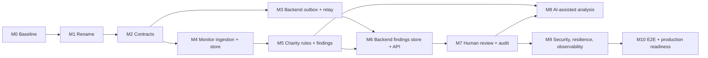

# 04 — Phased Implementation Roadmap (M0–M10)

All phases are sub-phases of **backend Phase 2 (AI monitoring integration)**. Labels as defined in [README.md](README.md). Acceptance criteria are summarised per phase; the tickable, canonical list with evidence columns is [05-acceptance-checklist.md](05-acceptance-checklist.md).

**Rule for implementers:** implement one phase per session. Start by re-reading the "Current-state evidence" files of that phase. If the code no longer matches, update this document before coding.

## Dependency graph and MVP line

| Phase | Name | Priority | Complexity | Human decision needed |
|---|---|---|---|---|
| M0 | Baseline verification | MVP-required | Low–Medium | No (fixing a failing test is a code change the owner should approve) |
| M1 | Module rename | MVP-required | Medium | D1, D11 |
| M2 | Contract alignment | MVP-required | Medium | D5, D10, D14 |
| M3 | Backend outbox and relay | MVP-required | High | D2 |
| M4 | Monitor ingestion hardening and store | MVP-required | High | D4, D8, D9 |
| M5 | Charity rules and findings | MVP-required | Medium | D12 |
| M6 | Backend findings store and admin API | MVP-required | Medium | D3, D7 |
| M7 | Human review and audit | MVP-required | Medium | D7 |
| M8 | AI-assisted analysis | Recommended (first post-MVP) | Medium–High | D5, D6, D13 |
| M9 | Security, resilience, observability | MVP subset required (marked ★); rest recommended | Medium | Alerting target; metrics exposure |
| M10 | End-to-end validation and production readiness | MVP E2E required; production items future (backend Phase 4) | High | Deployment platform |

**MVP = M0–M7 + M9★ + M10 MVP E2E.** M3 and M4/M5 can be built in parallel after M2.

### Status (2026-10-25)
| Phase | Status | Notes |
|---|---|---|
| M0 | DONE | Baselines recorded; failing Phase 1 test corrected; smoke boot done |
| M1 | DONE | Rename verified (01 §6) |
| M2 | DONE, partial | Contract finalized in `rise-ai-backend/docs/event-contracts.md`; no shared `contracts/` folder or JSON Schemas (D14 not applied) |
| M3 | DONE | Outbox, 20 events, relay; integration tests |
| M4 | DONE, with deviation | Service key, `riseai` profile, envelope reader, H2 projection, retention. Durable deduplication implemented 2026-10-30 (`JdbcEventDeduplicator`, migration V2; tests written, not executed) |
| M5 | DONE | Eight rules, `findings[]`, metrics, tests. Simulator Rise scenarios **not** added (rules are covered by `RiseMonitoringIntegrationTest`) |
| M6 | DONE | Findings store, admin read API, OpenAPI snapshot, boundary test (now `LayeredArchitectureTest`) |
| M7 | DONE | Review, conflict of interest, escalation reopen, audit. Precision query **not** built |
| M8 | PARTIAL (2026-10-29; timing review in progress report 12.2) | Allowlisted prompt, output filter, `aiNote` on findings, default off; pilot run on `qwen3.5:9b`. Evaluation gate (200 scenarios), latency fit and owner sign-off open; backend does not store `aiNote` |
| M9 | ★ items MOSTLY DONE | Done: outbox stats (★), requeue (★), `ALERT` log lines, key rotation (2026-10-29), monitor-side log-capture test (★, backend side not tested), runbook written (`07-operations-runbook.md`, not drilled). Alert persistence and dispatch implemented 2026-10-30 (`alert_notifications`, V10; tests written, not executed); the alert destination is still an owner decision |
| M10 | MVP E2E DONE (manual) | Scripted live run, not an automated test. 2026-10-29: Dockerfiles and root Compose verified (images built, stack started, 65 events PUBLISHED); CI workflow written but never run on a runner. Remaining production items belong to backend Phase 4 |

Evidence for each item: [05-acceptance-checklist.md](05-acceptance-checklist.md) and [06-progress-report.md](06-progress-report.md).

File paths in the phase descriptions below are the planned, pre-refactor locations. After the layered refactor (ADR-008, 2026-10-25), backend classes live under `controller/`, `service/`, `service/impl/`, `repository/`, `entity/`, `dto/`, `mapper/`, `client/` and `configuration/`, and the monitor's projection repository is `repository/RiseProjectionRepository`.

---

## M0 — Baseline verification

| Field | Content |
|---|---|
| Business objective | Know that both modules build, test and start before anything changes, so later regressions are attributable |
| Current-state evidence | Monitor never built with Maven; Spring tests never run (`local-ai-event-monitor/docs/TESTING.md:7,18`). Backend last full run 109/110 with `RequestIdempotencyIntegrationTest.reusingAKeyOnSomeoneElsesResourceDoesNotRevealIt` failing (`rise-ai-backend/docs/phase-1-business-hardening.md`, session checkpoint). The phase-1 doc still says the OpenAPI snapshot commit is pending, but `rise-ai-backend/docs/api/openapi-v1.json` is tracked in git (committed in `c541f9e`); update that doc line |
| Scope | Run, record, fix only what blocks a green baseline. No feature work |
| Existing files affected | Possibly `rise-ai-backend/src/test/java/com/riseai/.../RequestIdempotencyIntegrationTest.java` (expected `ACCESS_DENIED`, per the phase-1 doc diagnosis); monitor test or config files only if the first real Spring run exposes defects. Docs: monitor `docs/TESTING.md`, backend phase-1 doc |
| New files | none |
| Contracts / config | none |
| Prerequisites | Docker running (Testcontainers MySQL), JDK 21, network access to Maven Central (the wrapper download failed before) |
| Complexity / priority / decision | Low–Medium / MVP-required / owner approves any test fix |

Tasks, in order:
1. Backend: `mvn clean test`. Diagnose and fix the known failing test; rerun until all pass. Record counts.
2. Monitor: `./mvnw clean test`. This is the first real Spring run, so expect binding or wiring issues. Fix defects; record counts.
3. Monitor: `./mvnw clean package`, then `java -jar target/local-ai-event-monitor.jar --server.port=8081 --monitoring.ai.enabled=false`. Check health, status and one event.
4. Simulator against the running monitor with the documented `core-simulator.yml` profile and AI disabled. Record the summary.
5. Optional: with Ollama and the model installed, one AI-enabled event. Record the result or "not available".
6. Update both TESTING / progress docs with commands and results.

Acceptance (checklist §M0): both test suites green with counts recorded; monitor jar starts and answers health; simulator summary recorded.
Tests: existing suites only. Failure handling: if Maven Central is unreachable, stop and report; do not stub frameworks again.
Security / financial: none changed. Deliverables / DoD: recorded baseline in the checklist; no open test failures.

---

## M1 — Module rename

Full plan, naming table, change order, verification and rollback: [01-module-rename-plan.md](01-module-rename-plan.md).

| Field | Content |
|---|---|
| Business objective | One clear Rise AI identity for the monitoring service before integration code depends on its name |
| Current-state evidence | Naming inventory in 01 §1 (VERIFIED); no external references |
| Scope | Identity layers only (01 §3, rows marked R/RR). No behaviour change except default port 8081 |
| Existing files affected | Entire `local-ai-event-monitor/` tree (moved), both POMs, `application*.yml`, `.env.example`, `MonitoringMetrics.java`, `PlatformConstants.java`, main class, tests, module docs, root `docs/INDEX.md`, `docs/ai-monitoring/*` |
| New files | none (moves only) |
| Contracts / config | API, config keys and env vars preserved; metric names and default port change |
| Prerequisites | M0 baseline; D1, D11 approved |
| Complexity / priority / decision | Medium / MVP-required / D1, D11 |

Tasks: 01 §5 steps 1–11. Acceptance: 01 §6 V1–V11. Tests: unchanged suites must reach M0 counts. Failure handling and rollback: 01 §8. Security: none. DoD: single merged commit, stale-name sweep clean.

---

## M2 — Contract alignment

| Field | Content |
|---|---|
| Business objective | Agree, in executable form, what the backend sends and what the monitor returns, before either side builds against it |
| Current-state evidence | `rise-ai-backend/docs/event-contracts.md` (13 types, envelope v1, not emitted); monitor `MonitoringEventRequest` DTO lacks envelope fields; no finding contract exists |
| Scope | Finalize envelope v1 (architecture §5.1: add optional `actorRole` and `references`), the event catalogue (13 + proposed additions, §5.3), per-type payload allowlists and forbidden fields, the envelope→monitor mapping (§5.2), and `finding.v1` (§6) |
| Existing files affected | `rise-ai-backend/docs/event-contracts.md` (becomes canonical v1, status "FINAL, not yet emitted"); monitor `docs/API_CONTRACT.md` ("Proposed API changes": additive `findings[]`) |
| New files | `contracts/README.md`, `contracts/events/envelope.v1.schema.json`, `contracts/events/examples/<EVENT_TYPE>.json` (one per type), `contracts/findings/finding.v1.schema.json`, `contracts/findings/examples/*.json` (D14) |
| Contracts | Envelope v1, finding.v1, monitor response additive field |
| Prerequisites | M1; D5, D10, D14 |
| Complexity / priority / decision | Medium / MVP-required / D5, D10, D14 |

Tasks:
1. Write the envelope v1 schema and one example per event type. Payloads contain only allowlisted fields.
2. Write the finding.v1 schema and examples (one per MVP rule in 03 §3).
3. Update `event-contracts.md`: add `actorRole`, `references`, the proposed event types, the forbidden-field list and the compatibility rules (unchanged).
4. Document the monitor response's additive `findings[]` and the Rise-envelope reading rules in the monitor's `API_CONTRACT.md`.
5. Decide how tests consume fixtures. Recommended: tests read `../contracts/...` by relative path; no new dependency (Jackson structural assertions instead of a JSON Schema validator, unless a validator test dependency is approved).

Acceptance: every event in the catalogue has a schema-valid example; no example contains a forbidden field (checked by a script or test in M3/M4); both module docs link to `contracts/`.
Tests: introduced in M3 and M4 against these fixtures. Failure handling: n/a. Security / privacy: the forbidden-field list is the main privacy control; reviewed by the product owner. DoD: D5/D10/D14 recorded as approved; fixtures merged.

---

## M3 — Backend outbox and relay

| Field | Content |
|---|---|
| Business objective | Every committed business action of interest produces exactly one durable event, delivered at least once to the monitor, without affecting business availability |
| Current-state evidence | No publisher or outbox (architecture §1.1). Insertion points are the 13 call sites in architecture §5.3 plus the proposed ones. All are inside `@Transactional` service methods **except** `RECONCILIATION_RUN_COMPLETED`: `ReconciliationService.run` is not transactional, and the audit call sits inside `transactionTemplate.executeWithoutResult` in `ReconciliationService.save`. That outbox write must go inside the same lambda. `AuditService` uses `REQUIRED` propagation. `JwtServiceTest.java:19` constructs `RiseProperties` directly |
| Scope | Outbox table, envelope builder, writes at catalogue call sites, relay with lease, retry and dead-letter, HTTP client, response classification (architecture §7). Findings in the response are **logged and ignored** until M6 |
| Existing files affected | `CampaignService`, `DonationService`, `MilestoneService`, `EvidenceService`, `DisbursementService`, `DisputeService`, `RefundService`, plus `AdjustmentService`, `SettlementService`, `ReconciliationService` for proposed events; `src/main/resources/application.yml`; `src/test/resources/application*.yml` (relay disabled in tests by default) |
| New files | `db/migration/V8__outbox_events.sql`; package `com.riseai.outbox`: `OutboxEvent`, `OutboxStatus`, `OutboxEventRepository`, `EventEnvelope`, `OutboxWriter` (`Propagation.MANDATORY`), `RiseEventFactory` (per-type payload builders), `OutboxRelay` (`@Scheduled`, `@ConditionalOnProperty("rise.monitoring.enabled")`, its own `@EnableScheduling`), `MonitoringClient` (Spring `RestClient`, already in `spring-boot-starter-web`), `MonitoringClientProperties` (**separate** `@ConfigurationProperties("rise.monitoring")` record, so `RiseProperties` and `JwtServiceTest` stay untouched) |
| Contracts / config | Envelope v1 (M2); `rise.monitoring.*` (architecture §10) |
| Prerequisites | M2; D2 |
| Complexity / priority / decision | High / MVP-required / D2 |

Tasks:
1. V8 migration: columns as in architecture §7; indexes `(status, next_attempt_at)` and unique `event_id`.
2. Entity, repository, `OutboxWriter.write(envelope)`. It must run inside the caller's transaction (`MANDATORY`) and capture `RequestContext.correlationId()` at write time.
3. `RiseEventFactory`: one method per event type, building only allowlisted payload fields from the entities already loaded in the service method. Money as `toPlainString()` (same as `AuditService.meta`).
4. Add the outbox write next to each catalogue `auditService.transition/record` call. Do **not** hook `AuditService` generically: it also records logins with IP addresses, and it lacks payload fields.
5. `MonitoringClient` + response classifier (architecture §7 table); service key header (sent once M4 enforces it).
6. `OutboxRelay`: claim with `FOR UPDATE SKIP LOCKED` and a lease in a short transaction; HTTP outside any transaction; outcome in a new transaction; exponential backoff with jitter; `FAILED` after `max-attempts` or `retry-horizon`.
7. Configuration defaults: `enabled: false`.

Acceptance (checklist §M3):
- For each catalogue event, one committed operation gives exactly one outbox row matching the fixture shape.
- A rolled-back operation gives zero rows.
- Business endpoints behave identically with the monitor unreachable.
- The relay delivers, retries and dead-letters per the classification table.
- A redelivery after a simulated crash causes no duplicate effects.

Tests:
- Integration (`AbstractMySqlIntegrationTest`): outbox rows per operation; rollback leaves no row.
- Relay tests against a JDK `HttpServer` stub (no new dependency): 200, 409/2002, 409/2001, 400, 503, timeout.
- Contract test: rows match `contracts/events/examples` structurally and contain no forbidden fields.
- Concurrency: two relay instances do not double-send within a lease.
- Existing suite stays green.

Failure handling: architecture §7–8. Security / financial: outbox writes cannot change business state; the relay never runs in a business transaction. Payload allowlist enforced by the contract test.
DoD: tests green; `phase-2-ai-monitoring.md` progress updated.

---

## M4 — Monitor ingestion hardening and store

| Field | Content |
|---|---|
| Business objective | The monitor accepts only authenticated Rise events, survives restarts without re-analysing, and keeps the minimal history that cross-event rules need |
| Current-state evidence | No auth (`docs/DECISIONS.md` P1 open); at the time: in-memory dedup only (`InMemoryEventDeduplicator`); no persistence (monitor decision D2); `EventDeduplicator` interface allows a replacement. Superseded 2026-10-30 by `JdbcEventDeduplicator` |
| Scope | Service-key filter; localhost binding; Rise envelope reader; JDBC persistence (file database in the `riseai` profile; the default is in-memory H2, which is not durable); durable dedup (`JdbcEventDeduplicator`, durable only on a file or server database); projection tables; retention purge; `application-riseai.yml` |
| Existing files affected | `pom.xml` (**new dependencies**: `spring-boot-starter-jdbc`, `flyway-core`, `flyway-mysql`, `mysql-connector-j`; test: Testcontainers MySQL); `configuration/MonitoringProperties.java` (security, persistence, deduplication store); `filter/` (new filter); `docs/DECISIONS.md` (supersede D2, close P1); `docs/CONFIGURATION.md`; `MonitoringStatusServiceImpl` (`deduplicationStore` reports `JDBC`) |
| New files | `filter/ServiceKeyAuthenticationFilter`; `deduplication/JdbcEventDeduplicator`; package `rise/`: `RiseEnvelope`, `RiseEnvelopeReader`, `RiseProjectionRepository`; `src/main/resources/db/migration/V1__processed_events.sql`, `V2__rise_projection.sql` (tables: `processed_events(source, event_id, fingerprint, result_json, registered_at)`, `evidence_hashes(file_hash, evidence_id, milestone_id, campaign_id, event_id, occurred_at)`, `disbursement_history(milestone_id, request_id, event_type, amount, occurred_at, event_id)`, `milestone_releases(milestone_id, released_total, last_event_id)`); `application-riseai.yml`; retention job |
| Contracts / config | `MONITORING_SERVICE_KEY`, `MONITORING_DB_URL` / user / password, `monitoring.deduplication.store`, `monitoring.retention` (D9) |
| Prerequisites | M2; D4, D8, D9. The DB user has no grants on `rise_ai` |
| Complexity / priority / decision | High / MVP-required / D4, D8, D9 |

Tasks:
1. Add the service-key filter for `/api/v1/**` and actuator `metrics`: constant-time compare, 401 with a new `ErrorCode` (`UNAUTHENTICATED`, next free code in the 1xxx range). Health stays open.
2. `server.address: 127.0.0.1` in the `riseai` profile.
3. Persistence wiring behind `monitoring.persistence.enabled`; Flyway migrations.
4. `JdbcEventDeduplicator` with the same semantics as the in-memory one: NEW, DUPLICATE (stored result), CONFLICT, IN_PROGRESS, stale in-progress recovery after a timeout. Selected by `monitoring.deduplication.store`.
5. `RiseEnvelopeReader`: when `source == rise-ai-backend`, parse `payload` as envelope v1. Unknown `schemaVersion` → `INVALID_EVENT` (non-retryable at the relay).
6. Projection updates, idempotent per `eventId` (insert-ignore on unique `(event_id)`).
7. Retention purge (`@Scheduled`, deletes rows older than D9).
8. Set `max-event-age` and the allow-list for Rise types in `application-riseai.yml`.

Acceptance (checklist §M4):
- Requests without or with a wrong key → 401.
- Health is reachable without a key.
- After a restart, a redelivered event returns `duplicate: true` with the original result.
- Projection rows are written exactly once per event.
- Without the `riseai` profile, behaviour equals the M1 baseline (simulator summary unchanged).

Tests:
- Filter unit tests and MockMvc tests.
- `JdbcEventDeduplicator` against Testcontainers MySQL, including concurrency (two threads, same event).
- Envelope reader with every M2 fixture.
- Restart test (new context, same DB).
- Existing suite with the default profile.

Failure handling: DB unavailable → `/api/v1/events/monitor` returns 503 (retryable by the relay); health reports DB down. Security / privacy: projection holds only the fields listed; the key is never logged; retention purge.
DoD: tests green; monitor docs updated (`ARCHITECTURE`, `CONFIGURATION`, `DECISIONS`, `API_CONTRACT`).

---

## M5 — Charity rules and findings

| Field | Content |
|---|---|
| Business objective | Turn Rise events into explainable, deduplicated findings for the MVP rules in 03 §3 |
| Current-state evidence | `MonitoringRule` returns `RuleFinding` (single-event, no state); `MonitoringResultAssembler` derives risk only from rule findings; no finding concept |
| Scope | Rules EV-01, EV-02, DB-01, DB-02, DB-03, LG-01, AO-01, DP-01. `finding.v1` assembly. Additive `findings[]` in the response. Each finding also emits a `RuleFinding` (effect FLAG, same severity) so existing risk and review logic keeps working unchanged |
| Existing files affected | `service/impl/EventMonitoringServiceImpl.java` (call the finding stage after rule evaluation, before AI); `dto/response/monitoring/MonitoringResultResponse.java` (+`findings`); `mapper/MonitoringResultMapper.java`; `core/result/MonitoringResult.java`; `observability/MonitoringMetrics.java` (finding counters by rule); `application-riseai.yml` (thresholds) |
| New files | `core/finding/`: `Finding`, `FindingCategory`, `RecommendedAction`, `FindingDetector`, `FindingRule` interface (`List<Finding> evaluate(RiseEnvelope, ProjectionView)`), `FindingIdGenerator`. `rise/rule/`: one class per rule. `dto/response/monitoring/FindingResponse` |
| Contracts / config | finding.v1 (M2); thresholds `monitoring.rise.rules.*` (D12) |
| Prerequisites | M4; D12 (placeholders acceptable if marked) |
| Complexity / priority / decision | Medium / MVP-required / D12 |

Tasks:
1. Finding model and the deterministic `findingId` (architecture §6).
2. Implement rules in this order: LG-01, AO-01, EV-02 (stateless), then EV-01, DB-01, DB-02, DB-03, DP-01 (projection).
3. Explanation templates per rule. Language test against the forbidden list (03 §0.4).
4. Pipeline integration, mapper, response field, metrics.
5. Extend `test-simulator` with Rise scenarios (one positive and one negative per rule) using M2 fixtures.

Acceptance (checklist §M5):
- Each rule produces its finding for its positive fixture and none for its negative fixtures.
- The same event redelivered produces the same `findingId` and no new projection rows.
- Reversed event order produces no false finding.
- Every finding validates against `finding.v1.schema.json`.
- No template contains a forbidden term.

Tests: unit per rule (`MutableClock` for windows); service-level tests with `RecordingResultPublisher`; contract test on the response; simulator Rise scenarios.
Failure handling: a rule exception → that rule logs, emits a MEDIUM "could not be evaluated" flag (existing `RuleEngine` behaviour); other rules continue.
Security: facts contain only projection fields. DoD: tests green; 03 §3 rule table updated with any threshold changes.

---

## M6 — Backend findings store and admin API

| Field | Content |
|---|---|
| Business objective | Admins can see monitoring findings for campaigns, milestones and disbursements, with traceability to source events, without findings influencing any business decision |
| Current-state evidence | Relay from M3 receives `findings[]`; backend has ADMIN-only routing for `/api/v1/admin/**` (`SecurityConfig`); frozen OpenAPI snapshot `docs/api/openapi-v1.json`, checked by `OpenApiContractTest` |
| Scope | Findings tables, idempotent upsert from the relay, read-only admin endpoints, OpenAPI snapshot update, static boundary test |
| Existing files affected | `com.riseai.outbox.OutboxRelay` (pass findings to ingestion); `docs/api/openapi-v1.json` (regenerated; decide 1.0.0 → 1.1.0 as additive); `docs/api-specification.md`; `docs/database-design.md`; `docs/roles-and-permissions.md` |
| New files | `db/migration/V9__monitoring_findings.sql` (`monitoring_findings`, `monitoring_finding_occurrences` unique `(finding_id, source_event_id)`); package `com.riseai.finding`: `MonitoringFinding`, `FindingOccurrence`, repositories, `FindingIngestionService`, `FindingController` (`GET /api/v1/admin/monitoring/findings`, `GET …/{findingId}`), DTOs; `FindingBoundaryTest` |
| Contracts / config | finding.v1; admin API |
| Prerequisites | M3, M5; D3, D7 |
| Complexity / priority / decision | Medium / MVP-required / D3, D7 |

Tasks:
1. V9 schema.
2. Ingestion: upsert by `findingId`, severity escalation only, occurrence rows idempotent; runs in the relay's outcome transaction.
3. Admin read endpoints with filters and pagination (existing `PageResponse` conventions).
4. `FindingBoundaryTest`: no class in escrow, disbursement, refund, settlement, adjustment or donation packages imports `com.riseai.finding` (source scan; ArchUnit only if the dependency is approved).
5. Regenerate the OpenAPI snapshot.

Acceptance (checklist §M6):
- A delivered event with findings creates the expected rows.
- Redelivery changes nothing except `lastSeenAt` and occurrence rows, which never duplicate.
- Severity never decreases.
- Non-admin users get 403.
- The boundary test passes.
- `OpenApiContractTest` passes with the new snapshot.

Tests: integration via the relay with a stub monitor returning fixture findings; security tests per role; boundary test.
Failure handling: ingestion failure rolls back the outcome transaction → the outbox row is retried (idempotent).
Security / financial: read-only; ADMIN only; findings hold no personal data beyond UUIDs. DoD: docs and snapshot updated.

---

## M7 — Human review and audit

| Field | Content |
|---|---|
| Business objective | Every finding can be acknowledged, confirmed as a concern, or dismissed by an accountable admin, with an auditable trail and feedback for rule quality |
| Current-state evidence | `AuditService.transition` writes `status_history` and `audit_logs` with correlation ID and IP; `ErrorCode.CONFLICT_OF_INTEREST` exists |
| Scope | Review endpoint and state machine (D7), reviewer separation (HR-05), history endpoint, reopen-on-escalation, precision query |
| Existing files affected | `com.riseai.finding.*` (from M6); `docs/state-machines.md`; `docs/business-rules.md` (new numbered rules); `docs/audit-and-traceability.md`; OpenAPI snapshot |
| New files | `FindingReviewService`, `FindingStatus` enum, review DTOs; `V10__finding_review_columns.sql` if not included in V9 |
| Contracts / config | `POST /api/v1/admin/monitoring/findings/{findingId}/review` `{status, note}`; `GET …/{findingId}/history` |
| Prerequisites | M6; D7 |
| Complexity / priority / decision | Medium / MVP-required / D7 |

Tasks:
1. State machine with `States.require` (existing helper).
2. Review with a mandatory note, through `AuditService.transition` (entity `MONITORING_FINDING`).
3. HR-05 check against the finding's source-event actors and campaign creator.
4. Reopen on severity escalation (system actor).
5. Precision query (SQL view or admin endpoint) per rule.

Acceptance (checklist §M7):
- Each valid transition is audited with actor, note and correlation ID.
- Invalid transitions → `INVALID_STATE_TRANSITION`.
- A reviewer who is the campaign creator → `CONFLICT_OF_INTEREST`.
- A dismissed finding with a new same-severity occurrence stays dismissed; escalation reopens it.
- No review action changes any business entity.

Tests: integration per transition; conflict-of-interest; escalation reopen; audit row assertions.
Failure handling: optimistic locking on the finding (`version` column, as in other entities) → `CONCURRENT_MODIFICATION`.
DoD: business rules and state machine docs updated.

---

## M8 — AI-assisted analysis

| Field | Content |
|---|---|
| Business objective | Help reviewers understand findings faster, without AI deciding anything or seeing data it should not |
| Current-state evidence | `AnalysisPromptBuilder` (generic system prompt, redaction, payload excluded by default, IDs excluded); `AiOutputParser` schema validation; `OllamaEventAnalyzer`; fakes in testsupport |
| Scope | AI-01 only: charity-specific prompt, D5 attribute allowlist for Rise events, AI note attached to findings, forbidden-language output filter, prompt version, offline evaluation harness and gate (03 §5.2). Ships disabled (D6) |
| Existing files affected | `analysis/AnalysisPromptBuilder.java`, `analysis/AiOutputParser.java` (language filter → `INVALID_RESPONSE`), `service/impl/EventMonitoringServiceImpl.java` (AI on finding-bearing events), `application-riseai.yml`; `test-simulator` (evaluation mode); monitor `docs/AI_AND_OLLAMA.md` |
| New files | `analysis/RisePromptAllowlist`; evaluation scenario set in `test-simulator` |
| Contracts / config | `aiNote` in finding.v1; `monitoring.ai.enabled` stays false for Rise until the gate passes; Ollama URL restricted to loopback or private (D13) |
| Prerequisites | M5 (findings), M7 (labels improve evaluation); D5, D6, D13 |
| Complexity / priority / decision | Medium–High / Recommended / D5, D6, D13 |

Tasks: allowlist → prompt → note attachment → output filter → evaluation harness → run the gate on the chosen local model → record results → owner decides on enabling.
Acceptance (checklist §M8):
- Prompt-content tests prove that no ID, actor or free-text field reaches the prompt.
- The AI never changes severity (existing tests extended to findings).
- The evaluation gate metrics are recorded.
- Disabled-by-default behaviour is identical to M7.

Tests: prompt builder unit tests; parser filter tests; `StubOllamaServer` integration; offline evaluation (not in the CI gate; run manually).
Failure handling: existing statuses (`UNAVAILABLE`, `TIMEOUT`, `INVALID_RESPONSE`, `FAILED`) keep findings intact.
Security / privacy: local model only; prompt allowlist; prompt-injection posture unchanged (event data delimited and declared untrusted).

---

## M9 — Security, resilience, observability, operational controls

★ = part of the MVP.

| Field | Content |
|---|---|
| Business objective | Operators can see the pipeline's health, recover from failures and trust that data stays protected |
| Current-state evidence | Backend actuator exposes only `health,info`; monitor exposes `health,info,metrics` with `eventmonitor.*` counters (renamed in M1); no alerting; no FAILED-row replay |
| Scope | ★ outbox metrics (pending count, oldest pending age, failed count, publish latency) · ★ admin requeue of FAILED rows (`POST /api/v1/admin/monitoring/outbox/{id}/requeue`, audited) · ★ log-hygiene test (no payload at INFO) · service-key rotation (accept two keys) · retention verification · runbook · optional mTLS · backend metrics exposure decision |
| Existing files affected | backend `application.yml` (actuator exposure, if approved); `com.riseai.outbox`; monitor `ServiceKeyAuthenticationFilter`; `docs/security.md`; monitor `docs/DEVELOPMENT.md` |
| New files | `docs/ai-monitoring/runbook.md`; requeue controller and service |
| Prerequisites | M7 |
| Complexity / priority / decision | Medium / ★ MVP subset, rest recommended / alert target and metrics exposure |

Acceptance (checklist §M9):
- Metrics visible and correct under induced failure (monitor stopped → pending and oldest-age rise; restarted → drain to 0).
- Requeue is audited and works only for ADMIN.
- With the rotation overlap, both keys are accepted and the old key is rejected after removal.
- The runbook covers monitor down, Ollama down, `FAILED` rows, DB down and key rotation.

Tests: integration for metrics and requeue; filter tests for rotation; log capture test.

---

## M10 — End-to-end validation and production readiness

| Field | Content |
|---|---|
| Business objective | Prove the whole MVP works across both services; prepare packaging. Production hardening merges into backend Phase 4 |
| Current-state evidence | No Dockerfiles, CI, or E2E tests across modules (VERIFIED) |
| Scope | **MVP E2E (required):** scripted run with MySQL (compose), the monitor (`riseai`, AI disabled), the backend (monitoring enabled), and seeded flows exercising each MVP rule end-to-end to the admin findings API and review. **Future (backend Phase 4):** Dockerfiles (`rise-ai-backend`, `rise-ai-monitoring`), Compose services, CI pipeline, load test of relay throughput, backup and retention policy sign-off |
| New files | E2E test module or script (location decided in this phase; for example `e2e/`); later Dockerfiles and Compose additions named per 01 §3 row 34 |
| Prerequisites | M9★ |
| Complexity / priority / decision | High / MVP E2E required, rest future / deployment platform |

MVP acceptance (checklist §M10):
1. Evidence submitted twice with the same `fileHash` on two milestones → an EV-01 finding is visible to ADMIN within one relay interval plus processing time.
2. Monitor stopped → donations, disbursements and releases still succeed; restart → backlog drains; no duplicate findings.
3. Reconciliation inconsistency (injected in a test database) → LG-01 CRITICAL finding.
4. Review of a finding → audit log entry with the correlation ID.
5. No finding ever changes a business entity: compare business table checksums before and after review in the E2E run.

---

## Implementation rules that apply to every phase

- Keep the monitor's invariants: risk only from rules; AI never downgrades; no network at startup; Ollama not a health contributor.
- Follow each module's code style: the monitor uses no Java comments; the backend uses records and DTO classes as in existing packages.
- Never add a dependency without listing it in the phase notes for approval.
- Update the checklist with the command run and its result, not a summary claim.
