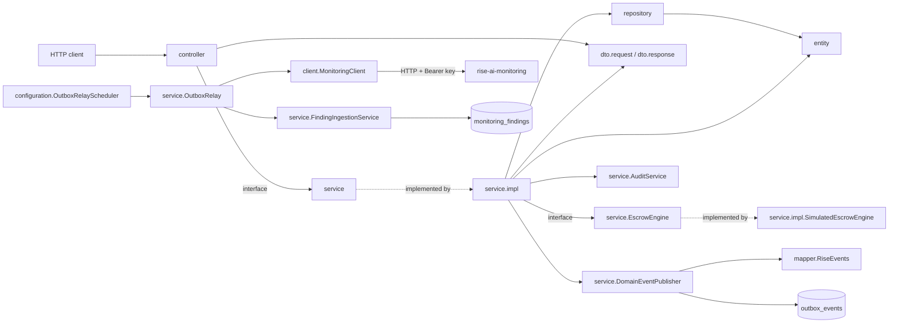

# Architecture — IMPLEMENTED

## Style
Modular monolith (ADR-001): one Spring Boot 3.3 / Java 21 application, one MySQL schema managed by Flyway. Since 2026-10-25, packages under `com.riseai` are organized by **technical layer** (ADR-008); before that they were organized by business capability (`campaign/`, `donation/`, …). Business capabilities are now visible in class names (`CampaignService`, `CampaignController`, `CampaignRepository`, `Campaign`).

## Package layout
```text
src/main/java/com/riseai/
├── RiseAiApplication.java   entry point (@SpringBootApplication, @ConfigurationPropertiesScan)
├── controller/      16 REST controllers (HTTP only; depend on service interfaces)
├── service/         22 interfaces: application services, EscrowEngine, DomainEventPublisher, OutboxRelay
│   └── impl/        22 implementations (@Service/@Component, transactions, business rules)
├── repository/      21 Spring Data JPA repositories
├── entity/          24 JPA entities, mapped superclasses and the BudgetItem JSON value
├── enums/           31 domain enums (statuses, types, roles)
├── dto/
│   ├── request/     23 API request records (Bean Validation annotations)
│   ├── response/    33 API response records, envelopes (ResponseAPI, PageResponse, ApiError) and query projections
│   └── event/       DomainEvent (internal event model for the outbox)
├── mapper/          RiseEvents (entity → DomainEvent with per-event payload allowlists)
├── client/          MonitoringClient (outbound HTTP to rise-ai-monitoring)
├── configuration/   SecurityConfig, CorrelationIdFilter, RiseProperties, MonitoringRelayProperties, OpenApiConfig, ScheduledJobs, OutboxRelayScheduler, DemoDataSeeder
├── security/        AuthUser (principal), JwtService, JwtAuthenticationFilter, SecurityErrorHandler
├── exception/       ErrorCode, ApplicationException, FindingContractException, GlobalExceptionHandler
└── util/            Codes, Money, Slugs, States, RequestContext, ProRataAllocation
```

## Layer responsibilities
| Layer | Contains | May depend on | Must not |
|---|---|---|---|
| `controller` | `@RestController`s: routing, `@Valid` request binding, `@PreAuthorize`, wrapping results in `ResponseAPI`/`PageResponse` | `service` interfaces, `dto`, `enums`, `security.AuthUser` | Access repositories or entities; hold business rules |
| `service` | Interfaces naming the application operations, plus shared constants (`CampaignService.PUBLIC_STATUSES`, `FindingIngestionService.ENTITY`) and `AuditService.meta(...)` | `dto`, `entity`, `enums` | Contain state |
| `service.impl` | Business orchestration, ownership and state-machine checks, `@Transactional` boundaries, row locking, audit and event writes | Other `service` interfaces, `repository`, `entity`, `dto`, `mapper`, `client`, `util`, `exception` | Depend on another `*Impl` class directly |
| `repository` | Spring Data interfaces, JPQL/native queries, constructor projections into `dto.response` records | `entity`, `enums`, `dto.response` projections | Contain workflows |
| `entity` | JPA mappings (unchanged by the refactor) | `enums`, JSON value types | Reference services or controllers |
| `dto.request` / `dto.response` | Immutable records. Responses expose `from(entity)` factories (existing convention, so there is no separate mapper per DTO) | `entity`, `enums`, `util` | Be returned as entities |
| `mapper` | Mapping that is complex or shared: `RiseEvents` builds minimized domain events | `entity`, `dto.event`, `security.AuthUser` | Call services |
| `client` | Outbound integrations | `configuration` properties, `entity.OutboxEvent` | Call business services |
| `configuration` | Spring/web/security configuration, properties records, schedulers, seeder | Any layer, for wiring | Contain business rules (schedulers delegate to services) |
| `security` | Authentication infrastructure shared by all layers | `repository.UserRepository`, `configuration` properties | — |
| `exception` | Error codes, application exceptions, global handler | `dto.response.ApiError` | — |
| `util` | Stateless helpers (money arithmetic, codes, slugs, state guard, pro-rata allocation, request context) | `exception` | Hold business workflows |

Deliberate exceptions to the generic layout:
- `security/` stays as one cross-cutting package (principal, token service, filter, entry point) instead of being split into `configuration`, `service` and `dto`. Every layer uses `AuthUser`, and only the configuration class `SecurityConfig` lives in `configuration/`.
- `client/` holds the outbound HTTP client to the monitor; it is neither a service nor configuration.
- `dto/event/` holds the internal event model, which is not an API DTO.
- `entity/ReconciliationRun` stores `dto.response.ReconciliationReport` values in its JSON column (the same shape the reconciliation API returns).
- `BudgetItem` lives in `entity/` because it is the JSON shape persisted in `campaigns.budget_breakdown`; request and response DTOs reuse it.

`LayeredArchitectureTest` (`src/test/java/com/riseai/architecture`) enforces the main rules: controllers import no repositories, entities or `service.impl`; repositories and entities import no services or controllers; business service implementations never reference monitoring findings; event delivery code never calls business services or the escrow engine.

## Relationships


## Rules
- Controllers hold no business logic; they pass the authenticated `AuthUser` and DTOs to service interfaces.
- Financial balance changes happen **only** inside `EscrowEngine` implementations. No other class writes `escrow_accounts` or `escrow_ledger_entries`.
- `EscrowEngine` methods use `Propagation.MANDATORY`: they must run inside the caller's business transaction, so ledger, aggregates, entity states and audit rows commit or roll back together.
- Bean dependency order (no cycles): Audit ← Escrow ← Campaign ← Milestone ← Evidence ← Disbursement ← Dispute; Campaign ← Donation ← FundraisingClose; Escrow ← Refund; Campaign + Escrow ← Settlement, Adjustment; EscrowQuery ← Reconciliation. Services depend on each other only through interfaces.
- Lock order: business row (settlement/adjustment/refund/donation/request) → campaign (settlement, fundraising close) → donations → milestone → escrow account.
- Scheduled jobs (`configuration/ScheduledJobs`, enabled by `rise.jobs.enabled`) call `ReconciliationService` and `FundraisingCloseService`. Both are safe on several instances: reconciliation only reads balances, and fundraising close locks the campaign row and is idempotent.

## Request flow
1. `configuration/CorrelationIdFilter` assigns or propagates `X-Correlation-Id` into MDC.
2. `security/JwtAuthenticationFilter` verifies the bearer token, loads the user from MySQL, rejects non-ACTIVE users and builds `AuthUser` (roles come from the database, not the token).
3. URL rules (`configuration/SecurityConfig`) and `@PreAuthorize` on controllers enforce coarse role access.
4. The service implementation enforces resource ownership, state machines and financial rules inside a transaction.
5. Escrow operations lock rows in a fixed order (business entity → milestone → escrow account), append ledger entries and update aggregates.
6. `AuditService` writes status history and audit rows in the same transaction. For monitored actions, `DomainEventPublisher` writes the outbox row in the same transaction.
7. `exception/GlobalExceptionHandler` maps failures to `ApiError` without exposing internals.

## Concurrency control
Pessimistic `SELECT … FOR UPDATE` on the business row, milestone and escrow account; `@Version` optimistic locking on mutable entities; unique `idempotency_key` on ledger entries; DB CHECK constraints on balances and milestone amounts; DB triggers forbidding UPDATE/DELETE on ledger, audit, status-history and finding-occurrence tables.

## AI monitoring integration (Phase 2, ADR-004, ADR-007)
```
service.impl (@Transactional) ──(same tx)──▶ DomainEventPublisher ──▶ outbox_events (PENDING)
OutboxRelayScheduler ──▶ OutboxRelay: claim (FOR UPDATE SKIP LOCKED + lease) ──▶ MonitoringClient POST rise-ai-monitoring /api/v1/events/monitor
                         ◀── 200 + findings[] ── outcome tx: outbox PUBLISHED + FindingIngestionService upsert
admin ──▶ FindingController /api/v1/admin/monitoring/** ──▶ FindingService (review → AuditService)
```
- Services publish events with `DomainEventPublisher.publish(RiseEvents.…)` next to their `AuditService` call; the publisher requires an existing transaction (`Propagation.MANDATORY`).
- The relay never holds database locks during the HTTP call and never runs inside a business transaction. With `rise.monitoring.enabled=false` (default), events accumulate as `PENDING` and nothing is sent.
- **No business service depends on findings.** Escrow, disbursement, refund, settlement, adjustment, donation and the other business implementations never read findings (`LayeredArchitectureTest`); findings cannot approve, block or release anything. Reviewers act through the existing endpoints, with their normal authorization.
- The monitor has no credentials for this database and never calls this backend.

## Replaceable escrow boundary
`service/EscrowEngine` (implemented by `service/impl/SimulatedEscrowEngine`) is the abstraction kept for future use (ADR-003). Phase 3 adds an Avalanche-backed implementation behind it; see `phase-3-avalanche.md`.
