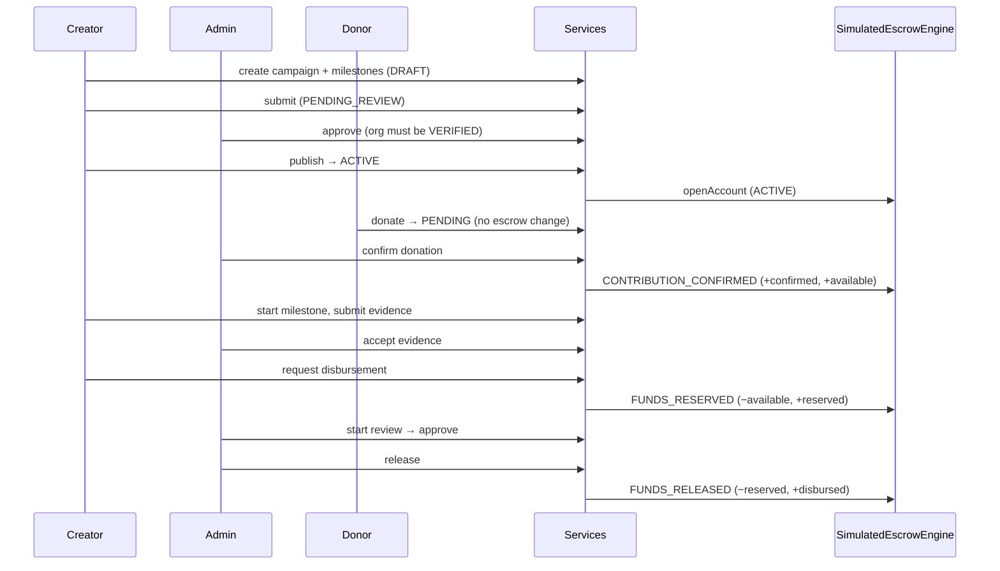

# Escrow Lifecycle — IMPLEMENTED (simulation)

## Stages
1. **Campaign creation** — DRAFT with milestones whose planned amounts sum to the target.
2. **Review & publication** — admin approval, then publish opens one escrow account (campaign, VND) and makes milestone #1 READY.
3. **Donations** — PENDING until an admin simulates confirmation; confirmation, ledger entry, aggregates and audit commit in one transaction.
4. **Reservation** — creating a disbursement request immediately reserves the amount so no concurrent request can use it.
5. **Evidence** — metadata with simulated file references (`sim://…`) and optional SHA-256 hash.
6. **Review** — SUBMITTED → UNDER_REVIEW → (NEEDS_MORE_EVIDENCE ↔ UNDER_REVIEW) → APPROVED or REJECTED.
7. **Release** — APPROVED → RELEASED; moves reserved to disbursed. **Simulated: no real transfer.**
8. **Milestone completion** — admin completes; next milestone becomes READY.
9. **Disputes** — hold open requests on the milestone; resolution rejects or restores them.
10. **Refunds** — request → approve (reserves the amount, Phase 1) → record (releases the reservation and records the refund); draws from available balance only.
11. **Pause** — escrow FROZEN: no contributions, reservations or releases; refunds and reservation cancellations still allowed.
12. **Completion/cancellation** — escrow SETTLEMENT: refunds and cancellations only.
13. **Settlement (Phase 1, ADR-006)** — an ADMIN proposes a pro-rata refund of the leftover available balance; a second ADMIN approves; one `SETTLEMENT_REFUND_RECORDED` entry is written per donation. Simulated: no external payment.
14. **Fundraising close (Phase 1)** — once `endAt` passes, a scheduled job stops confirmations and fails remaining PENDING donations. Milestones and disbursements continue.
15. **Adjustments (Phase 1)** — dual-controlled CREDIT/DEBIT corrections in any escrow status.

## Balance meanings
| Term | Meaning |
|---|---|
| Planned budget | Sum of milestone planned amounts (intent, not money) |
| Confirmed contributions | Sum of confirmed simulated donations |
| Reserved | Committed to open disbursement requests |
| Disbursed | Released by simulation |
| Refunded | Recorded refunds, including settlement refunds |
| Refund reserved | Committed to approved, not yet recorded refunds (Phase 1) |
| Adjustment credits / debits | Dual-controlled corrections (Phase 1) |
| Available | Unallocated: confirmed + credits − debits − reserved − refund reserved − disbursed − refunded |
| Held | Still inside simulated escrow: confirmed + credits − debits − disbursed − refunded |

## Limitations
Internal MySQL simulation; no on-chain locking; no external payout or refund; evidence is not proof; organization verification is not legal verification.
