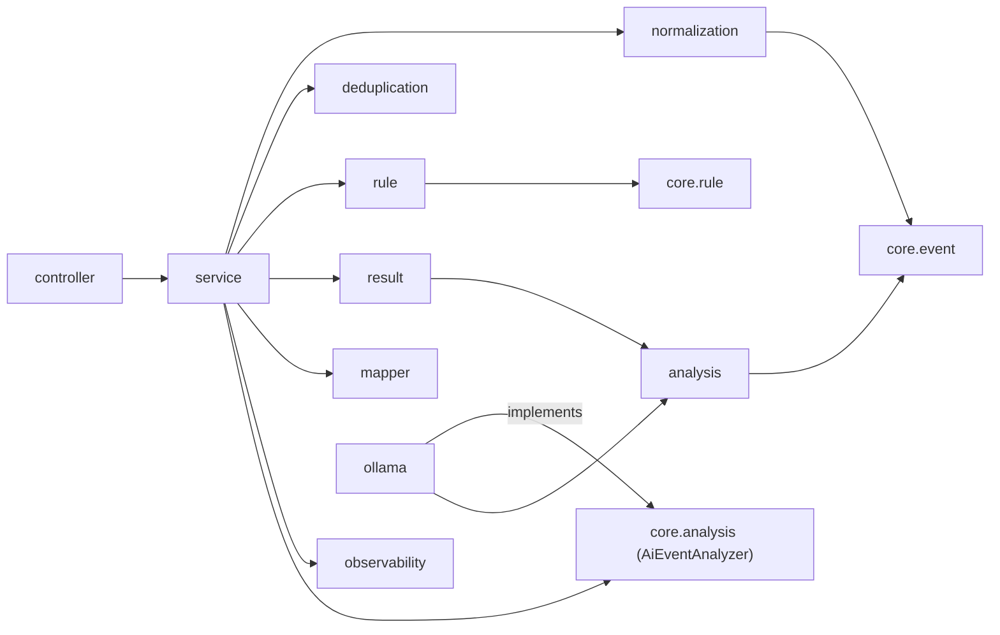
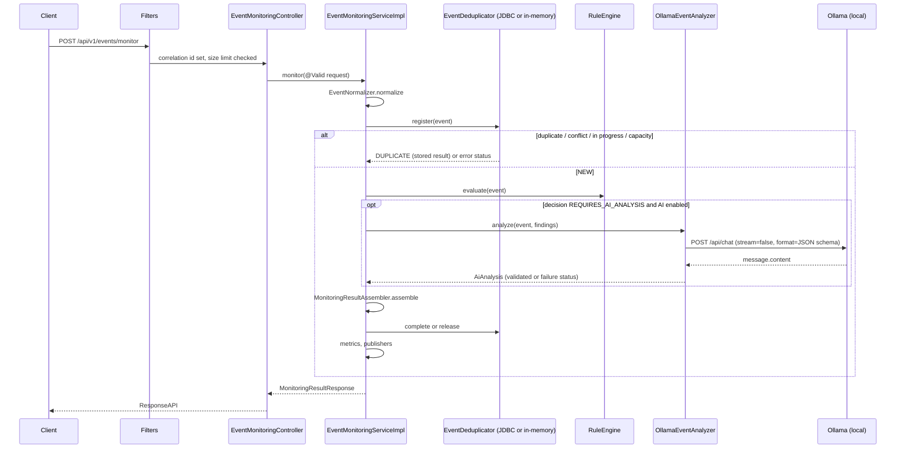

# Architecture

Everything in the **Implemented architecture** sections is verified from the source in `src/main/java/com/riseai/monitoring`. Anything not yet built is confined to [Future architecture](#future-architecture-not-implemented).

## Shape

A **single Spring Boot application** (modular monolith). Package boundaries are by convention, not by Maven modules.

The repository also contains `test-simulator/`, a **separate** Maven project that tests a running Core over HTTP. It is not part of the Core's architecture or build; see [TEST_SIMULATOR.md](TEST_SIMULATOR.md).

Layer packages follow the reference code style and the Rise AI layered convention (`controller`, `service` / `service.impl`, `repository`, `dto.request` / `dto.response`, `configuration`, `exception`, `mapper`). The pipeline packages (`core`, `rule`, `analysis`, `ollama`, `normalization`, `deduplication`, `result`, `rise`) are deliberately kept: they hold interface-based domain components (rules, analyzers, adapters), not CRUD layers, and are documented below. There are no JPA entities; `core` holds the immutable domain model.

Conventions shared with the reference code style:

- `controller`, `service` / `service.impl`, `dto.request.*` / `dto.response.*`, `exception`, `configuration`, `constants`;
- Lombok DTOs;
- the `ResponseAPI<T>` envelope;
- `ErrorCode` + `ApplicationException` + `GlobalExceptionHandler`.

## Implemented architecture

### Packages and responsibilities

| Package | Key types | Responsibility |
|---|---|---|
| `controller` | `EventMonitoringController`, `MonitoringStatusController` | Thin REST layer that wraps service results in `ResponseAPI` |
| `service`, `service.impl` | `EventMonitoringService` / `EventMonitoringServiceImpl`, `MonitoringStatusService` / `MonitoringStatusServiceImpl` | `EventMonitoringServiceImpl` is the **only orchestrator** of the pipeline |
| `dto.request.event`, `dto.response.*` | `MonitoringEventRequest`, `MonitoringResultResponse`, `RuleFindingResponse`, `AiAnalysisResponse`, `MonitoringStatusResponse`, `AiRuntimeStatusResponse`, `RuleResponse`, `ResponseAPI`, `ErrorResponse` | API contract types |
| `core.event` | `MonitoringEvent`, `Severity` | Normalized, immutable event |
| `core.rule` | `MonitoringRule` (interface), `RuleFinding`, `RuleEffect`, `RuleCategory`, `RuleDecision`, `RuleEvaluation` | Rule contracts |
| `core.analysis` | `AiEventAnalyzer` (interface), `AiAnalysis`, `AiAssessment`, `AiConfidence`, `AnalysisStatus`, `RiskLevel`, `AiRuntimeStatus`, `AiRuntimeState` | AI contracts, independent of any runtime |
| `core.result` | `MonitoringResult`, `MonitoringStatus`, `MonitoringResultPublisher` (interface) | Result model and delivery extension point |
| `core.finding` | `Finding`, `FindingFact`, `FindingCategory`, `RecommendedAction` | `finding.v1` model and deterministic `findingId` (`Finding.idFor`) |
| `rise` | `RiseEnvelope`, `RiseEnvelopeReader`, `RiseFindingEngine`, `RiseFindingRule` (interface), `RiseEventTypes` | Rise AI charity monitoring: envelope validation, finding generation |
| `repository` | `RiseProjectionRepository` | JDBC access to the minimized Rise projection (the only persistence in the module) |
| `rise.rule` | Eight `RiseFindingRule` implementations, `RuleSupport` | MVP charity rules EV-01, EV-02, DB-01, DB-02, DB-03, LG-01, AO-01, DP-01 |
| `normalization` | `EventNormalizer` | Trims and normalizes, validates attributes and payload depth, computes size and fingerprint |
| `deduplication` | `EventDeduplicator` (interface), `JdbcEventDeduplicator` (default), `InMemoryEventDeduplicator`, `DeduplicationOutcome`, `DeduplicationStatus` | Idempotency: per database (JDBC) or per instance (in-memory) |
| `rule` | `RuleEngine`, `RequiredFieldsRule`, `TimestampRule`, `EventTypeRule`, `PayloadLimitsRule`, `AttributeThresholdRule`, `ReportedSeverityRule` | Deterministic evaluation and the AI decision |
| `analysis` | `AnalysisPromptBuilder`, `AiOutputParser`, `AiAssessmentOutput`, `AnalysisPrompt`, `InvalidAiOutputException`, `RiskLevelNormalizer` | Prompt construction, output validation, severity→risk mapping. No Ollama types. |
| `ollama`, `ollama.dto` | `OllamaClient`, `OllamaEventAnalyzer`, `OllamaException`, `OllamaErrorType`, `OllamaChatRequest`, `OllamaChatResponse`, `OllamaChatMessage`, `OllamaTagsResponse`, `OllamaModel` | **The only place with Ollama-specific formats** |
| `result` | `MonitoringResultAssembler`, `LoggingMonitoringResultPublisher` | Deterministic status, risk and review; log-based delivery |
| `mapper` | `MonitoringResultMapper` | Domain → response DTO |
| `observability` | `MonitoringMetrics` | Micrometer counters and timer |
| `filter` | `CorrelationIdFilter`, `ServiceKeyAuthenticationFilter`, `RequestSizeLimitFilter`, `RequestBodyTooLargeException` | Correlation ID; service-key check for `/api/v1/**` and `/actuator/metrics/**`; request body limit for `/api/v1/events/**` |
| `exception` | `ErrorCode`, `ApplicationException`, `GlobalExceptionHandler` | Error codes and the error response |
| `configuration` | `MonitoringProperties` (`monitoring.*`), `OllamaProperties` (`ollama.*`), `ClockConfig`, `SchedulingConfig` | Validated configuration (see [CONFIGURATION.md](CONFIGURATION.md)); scheduling for the projection retention purge |
| `constants` | `PlatformConstants` | Header name, MDC keys, identifier regexes, `EVENT_API_PATH` |

### Dependency direction

Key rules:

- `core.*` depends on nothing Ollama- or HTTP-specific.
- The orchestrator depends on the `AiEventAnalyzer` **interface**. `OllamaEventAnalyzer` is the only implementation bean.
- Rules never call the AI. The AI never sees `eventId` or `correlationId`.

### Request flow

[EVENT_LIFECYCLE.md](EVENT_LIFECYCLE.md) is the detailed and canonical description of this flow.

### Extension points (implemented interfaces)

| Interface | Default implementation | Discovered how |
|---|---|---|
| `MonitoringRule` | Six rules in `rule` | All beans, injected as `List<MonitoringRule>` into `RuleEngine`. IDs must be unique, checked in the constructor. |
| `AiEventAnalyzer` | `OllamaEventAnalyzer` | Single bean. A second bean would make injection ambiguous unless marked `@Primary`. |
| `EventDeduplicator` | `JdbcEventDeduplicator` (`monitoring.deduplication.store=jdbc`, default) or `InMemoryEventDeduplicator` (`memory`) | Selected by `@ConditionalOnProperty` |
| `MonitoringResultPublisher` | `LoggingMonitoringResultPublisher` | All beans, as `List<MonitoringResultPublisher>`. Called only for newly produced results, not for replays. |
| `RiseFindingRule` | Eight rules in `rise.rule` | All beans, as `List<RiseFindingRule>` into `RiseFindingEngine`. IDs must be unique, checked in the constructor. |

### Rise AI charity monitoring

Implemented 2026-10-25 for integration with `rise-ai-backend`.

- **Input.** Events with `source = monitoring.rise.source` carry the backend's envelope (schema version 1) as `payload`. `RiseEnvelopeReader` validates it; anything inconsistent is `INVALID_EVENT` (400).
- **Pipeline position.** In `EventMonitoringServiceImpl.evaluate`, after the generic rules. Skipped when the generic rules REJECT the event. `RiseFindingEngine.evaluate` runs every `RiseFindingRule` against history recorded **before** this event (all reads exclude the current `eventId`), then records the event in the projection. One transaction per event.
- **Projection store.** Flyway migration `db/migration/V1__rise_projection.sql`: `rise_processed_events`, `rise_evidence_hashes`, `rise_disbursement_events`; migration `V2__dispute_projection_and_event_ledger.sql` adds `rise_dispute_events` (misuse-of-funds disputes, for DP-01 reverse delivery) and `monitoring_event_ledger` (the persistent deduplication ledger: source, event id, fingerprint, state and the stored response JSON). Only identifiers, enum values, amounts, timestamps and file hashes. Inserts are keyed by `event_id`, so recording is idempotent across redelivery and monitor restarts. Default database: in-memory H2; the `riseai` profile uses a file-backed H2 database (`./data/rise-ai-monitoring`). Any JDBC URL can be supplied via `MONITORING_DB_URL`, but only H2 has a driver on the classpath and only H2 was tested. A daily job deletes rows older than `monitoring.rise.projection-retention` (400 days).
- **Order tolerance.** Rules consider only history whose `occurredAt` is not after the current event. When a needed earlier event arrives late, the rule produces no finding rather than a wrong one (a known miss, documented per rule).
- **Output.** `Finding` objects are returned in `findings[]` and also converted into `FLAG` rule findings, so risk level and review reasons are computed by the existing assembler.
- **Boundaries.** The monitor has no credentials for the backend database and never calls the backend. Findings carry no decision fields; the backend stores them as advisory records.

### Architectural constraints

These are enforced by code and/or tests:

- **Risk comes only from rule findings.** `MonitoringResultAssembler` never reads AI output for `overallRiskLevel`; the AI affects only `reviewRequired` / `reviewReasons`. This is tested.
- **AI failure never erases rule findings,** and never yields `LOW` risk when AI was required and missing.
- **Startup makes no network calls.** `OllamaClient` creates its `HttpClient` at construction but sends no request until analysis or a status check. This is tested. (Startup does open the local H2 database and run Flyway migrations.)
- **Charity findings are deterministic and advisory.** Explanations are fixed templates; a test checks that no explanation contains accusatory terms. AI output never creates, removes or changes a finding.
- **The Ollama adapter calls only `/api/chat` and `/api/tags`** on the configured base URL, without following redirects.
- **Ollama is not a health contributor.** `/actuator/health` does not depend on it.
- **No Java comments or Javadocs** in source files (project convention).

## Future architecture (not implemented)

These are ideas only; none exist in the code. See [ROADMAP.md](ROADMAP.md) and [DECISIONS.md](DECISIONS.md).

- `JdbcEventDeduplicator` is the default store (`monitoring.deduplication.store=jdbc`) and keeps the response of every completed event in `monitoring_event_ledger`, so a redelivery after a restart returns `duplicate: true` and the original result. An in-progress row older than `monitoring.deduplication.in-progress-timeout` (5 minutes) is treated as abandoned and taken over. With the default in-memory H2 database the ledger is as short-lived as the process; durability requires a file or server database (`riseai` profile). Multi-instance use needs a shared database server, which has not been tested. The in-memory store remains available with `monitoring.deduplication.store=memory`.
- `MonitoringResultPublisher` implementations that push findings to the backend (needed for time-based rules such as overdue milestones, which have no triggering event).
- Asynchronous processing, where the request returns immediately and the result is delivered later.
- Extraction into a reusable library or Spring Boot starter.
