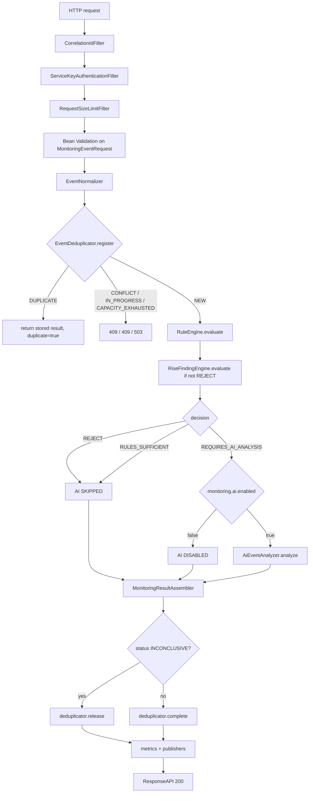

# Event Lifecycle

This is the canonical description of how one event is processed. Everything here is verified from source; class names are given so you can check.

## Pipeline

| Step | Class | What happens | Failure result |
|---|---|---|---|
| 1 | `CorrelationIdFilter` | Validates `X-Correlation-Id` or generates a UUID. Sets a request attribute, the response header and MDC `correlationId`. | (none) |
| 2 | `RequestSizeLimitFilter` | Applies to `/api/v1/events/**` only. Rejects a declared `Content-Length` over the limit; wraps the stream to catch chunked overflow. | 413 / 1005 |
| 3 | Bean Validation (`@Valid` in controller; `@Validated` service for in-process calls) | Required fields, patterns, lengths | 400 / 1000 |
| 4 | `EventNormalizer.normalize` | Trims IDs; lower-cases `eventType`; defaults `receivedAt` to `Clock` time; resolves `correlationId`; validates attributes (scalar values, length limit, unique trimmed keys) and sorts them; checks payload depth; deep-copies the payload; computes `payloadBytes` and a SHA-256 `fingerprint` | 400 / 2000 |
| 5 | `EventDeduplicator.register` | See [Duplicate detection](#duplicate-detection) | 409 / 2001, 409 / 2002, 503 / 2003 |
| 1b | `ServiceKeyAuthenticationFilter` | Only when `monitoring.security.service-key` is set: `/api/v1/**` and `/actuator/metrics/**` need `Authorization: Bearer <key>` | 401 / 1006 |
| 6 | `RuleEngine.evaluate` | Runs active rules and computes the decision | A rule that throws becomes a MEDIUM FLAG finding |
| 6b | `RiseFindingEngine.evaluate` (skipped when step 6 decided `REJECT`) | For `source = rise-ai-backend` only: `RiseEnvelopeReader` validates the envelope; each `RiseFindingRule` runs against projection history recorded before this event; the event is then recorded in the projection (idempotent per `eventId`). Each finding is added to the rule findings as a `FLAG`, and the decision is recomputed (`RuleEngine.withAdditionalFindings`) | Invalid envelope: 400 / 2000. A rule that throws is logged and skipped |
| 7 | `EventMonitoringServiceImpl.analyzeIfRequired` | `REJECT` → `SKIPPED`; `RULES_SUFFICIENT` → `SKIPPED`; AI disabled → `DISABLED` (no call); otherwise `AiEventAnalyzer.analyze`. An exception or `null` result becomes `FAILED`. | Never throws |
| 8 | `MonitoringResultAssembler.assemble` | Status, risk, review | (none) |
| 9 | Deduplicator | `INCONCLUSIVE` → `release`, so the event can be retried; otherwise `complete`, which stores the result, **including `REJECTED`** | (none) |
| 10 | `MonitoringMetrics`, `MonitoringResultPublisher` beans | Counters and timer; publishers are called, and their exceptions are logged and ignored | (none) |

Step 5 outcomes are handled in `EventMonitoringServiceImpl.handleDeduplicationOutcome`. Steps 6–8 (including 6b) run inside `EventMonitoringServiceImpl.evaluate`. A stored result replayed for a duplicate includes its `findings`. If that method throws, the deduplication entry is released **before** the exception propagates:

- `ApplicationException` and `java.lang.Error` are rethrown unchanged;
- any other `RuntimeException` is logged and becomes 500 / 9000 (`MONITORING_FAILED`).

MDC `eventId` is set during steps 5–10, so log lines carry `[correlationId,eventId]`.

## eventId versus correlationId

| | `eventId` | `correlationId` |
|---|---|---|
| Meaning | Identity of this event, assigned by the source. Stays stable across retries of the same event. | Links related activity across systems. Many events may share it. |
| Required | Yes | No. Resolved from the body field, then the MDC value set by the header filter, then a generated UUID. In-process callers without the filter get a UUID. |
| Used for | Deduplication key (with `source`), logs, response | Logs, tracing, response |
| Sent to AI | No | No |
| Part of the fingerprint | No (it is part of the key) | No |

The two values are never derived from each other.

## Duplicate detection

Implemented by `JdbcEventDeduplicator` (default) or `InMemoryEventDeduplicator` (`monitoring.deduplication.store=memory`). The in-memory store uses synchronized methods; the JDBC store relies on the primary key `(source, event_id)` of `monitoring_event_ledger`, so concurrent inserts for one key produce exactly one `NEW`, and each statement commits on its own (the ledger is never part of the projection transaction).

- **Key:** `source` + `'\u0000'` + `eventId`, using normalized (trimmed) values.
- **Fingerprint:** SHA-256 of a canonical JSON object containing `eventType`, `source`, `occurredAt`, `severity`, the attributes (sorted) and the payload (object keys sorted recursively). `receivedAt` and `correlationId` are excluded. Numbers are compared by their JSON representation, so `1` and `1.0` differ.
- **Retention:** `monitoring.deduplication.retention` (default 24 h), measured from registration. Expired entries are purged lazily on `register` and `getTrackedEventCount`.
- **Capacity:** `monitoring.deduplication.max-tracked-events` (default 10 000). When full, the oldest *completed* entry is evicted. In-progress entries are never evicted; if none is completed, the result is `CAPACITY_EXHAUSTED` (503).
- **Disabled** (`monitoring.deduplication.enabled=false`): every event is `NEW`.

| Situation | Outcome |
|---|---|
| Same key, same fingerprint, result stored | `DUPLICATE`: the stored result is returned with `duplicate: true`. Nothing is re-evaluated, the AI is not called, and publishers are not called. |
| Same key, same fingerprint, still processing | `IN_PROGRESS` → 409 / 2002 |
| Same key, different fingerprint | `CONFLICT` → 409 / 2001 |
| Previous attempt `INCONCLUSIVE` or failed | Entry released → processed again as `NEW` |
| Previous attempt `REJECTED` | Stored → identical resend replays `REJECTED` |
| Expired, evicted, or after restart | Not detected → processed as `NEW` |

**Guarantees and limits**

- At most one concurrent processor per key: in-memory, within one JVM (tested with 16 threads); JDBC, across every instance sharing the database (insert race and takeover race covered by `JdbcEventDeduplicatorTest`, which passed; its threads share one JVM and one H2 database, so multi-process behaviour is unverified).
- A completed response is stored (JDBC: as JSON in `monitoring_event_ledger.result_json`) and replayed with `duplicate: true` until `monitoring.deduplication.retention` (24 h) has passed; expired rows are removed per key on registration and by a daily purge.
- An in-progress row older than `monitoring.deduplication.in-progress-timeout` (5 minutes) is taken over by the next delivery; exactly one taker wins. The timeout must stay above the longest legitimate processing time (AI timeouts included), otherwise a slow first processor and the taker can both evaluate the event (the projection writes and finding ids are idempotent, so the outcome is the same).
- Failure scenarios (JDBC store): (1) registration succeeded and projection processing failed: the engine transaction rolls back, `release` deletes the in-progress row, the caller gets a 5xx and retries as new. (2) The process crashes while in progress: the row stays; retries get 409 code 2002 (retryable) until `in-progress-timeout`, then one retry takes over. (3) The projection commits but `complete` fails: the service releases the row, so the retry is evaluated as new (`markProcessed` returns false, the projection is not written twice and the findings are regenerated with the same ids); if even `release` fails the row recovers by timeout. (4) Concurrent requests for one event: one `NEW`, the others 409 code 2002. (5) Two requests racing to take over a stale row: exactly one wins. None of these leaves an event permanently stuck or reports it completed without a stored response.
- Durability depends on the database: with `jdbc:h2:mem:` (the default URL) the ledger is lost on restart and the monitor logs a warning at startup; the status endpoint then reports an in-memory scope. There is no exactly-once guarantee in either store.
- **Release on failure:** any exception or `java.lang.Error` thrown while evaluating releases the in-progress entry, so a retry is processed as new. The `Error` path is covered by `EventMonitoringServiceImplTest.anErrorDuringEvaluationAlsoReleasesTheRegistration`; a failure while storing the result (`complete`) also releases the entry (`aFailureWhileStoringTheResultReleasesTheRegistration...`). With the JDBC store a JVM crash leaves the in-progress row in `monitoring_event_ledger`; it is taken over once `monitoring.deduplication.in-progress-timeout` has passed. A Rise rule that throws fails the event with error 9001 (HTTP 500, retryable by the backend outbox) after every rule has run. Failure semantics: the healthy rules are still evaluated, but their findings are not returned for the failed attempt, because answering 200 would stop the backend retrying and the failing rule would never run again. Nothing is written for the failed attempt (the projection is recorded only after all rules succeed, inside the same transaction), the failure is counted in `riseai.monitoring.rise.rule.failures` tagged by rule, and it is logged with the rule id, event id and exception class only (no exception message, so no payload content). The deduplication slot is released, so the redelivery is evaluated as new, produces the complete finding set with the same deterministic `findingId`s, and writes each projection row once (`RiseRuleFailureIsolationIntegrationTest`). Until the rule is fixed the event stays failed and, after the backend exhausts its attempts, becomes a `FAILED` outbox row with an alert; no finding is silently dropped, but none is delivered either.

## Deterministic rules

Rules are beans implementing `MonitoringRule`, sorted by category (VALIDATION first) and then by ID.

| ID | Class | Category / effect | Checks |
|---|---|---|---|
| `required-fields` | `RequiredFieldsRule` | VALIDATION / REJECT | `eventId`, `eventType`, `source`, `occurredAt`; each name in `monitoring.rules.required-attributes` |
| `timestamp-validity` | `TimestampRule` | VALIDATION / REJECT | `receivedAt` ≤ now + `max-clock-skew`; `occurredAt` ≤ `receivedAt` + skew; `occurredAt` ≥ `receivedAt` − `max-event-age` |
| `supported-event-type` | `EventTypeRule` | VALIDATION / REJECT | `eventType` in `allowed-event-types` (case-insensitive; an empty list allows all) |
| `payload-limits` | `PayloadLimitsRule` | VALIDATION / REJECT | `payloadBytes` ≤ `max-payload-bytes`; attribute count ≤ `max-attributes` |
| `attribute-threshold` | `AttributeThresholdRule` | MONITORING / FLAG | Each configured threshold: numeric value (number or numeric string) vs `min`/`max`, optionally per event type. A non-numeric value gives a MEDIUM flag. |
| `reported-severity` | `ReportedSeverityRule` | MONITORING / FLAG | Request `severity` ≥ `flag-reported-severity-at` → flag carrying that severity |

- VALIDATION rules always run.
- MONITORING rules run only when `monitoring.rules.enabled` is true and their ID is not in `disabled-rules`.
- A rule that throws produces `FLAG`/`MEDIUM` "rule could not be evaluated".

**Decision** (`RuleEngine.decide`):

1. Any `REJECT` finding → `REJECT`.
2. Otherwise, any `FLAG` finding, or `monitoring.ai.trigger=ALWAYS`, or the event type in `always-analyze-event-types` → `REQUIRES_AI_ANALYSIS`.
3. Otherwise → `RULES_SUFFICIENT`.

## Result assembly

`MonitoringResultAssembler` is deterministic.

**Status:**

| Decision | AI outcome | `monitoringStatus` |
|---|---|---|
| `REJECT` | (any) | `REJECTED` |
| `RULES_SUFFICIENT` | (any) | `COMPLETED` |
| `REQUIRES_AI_ANALYSIS` | `COMPLETED` | `COMPLETED` |
| `REQUIRES_AI_ANALYSIS` | `DISABLED` or `SKIPPED` | `COMPLETED_WITHOUT_AI` |
| `REQUIRES_AI_ANALYSIS` | any other status | `COMPLETED_WITHOUT_AI` if `monitoring.ai.on-failure=RULES_ONLY`, else `INCONCLUSIVE` |

**`overallRiskLevel`** (never derived from AI output):

| Situation | Risk |
|---|---|
| `REJECTED` | `UNKNOWN` |
| Any FLAG findings | Highest flag severity, mapped by `RiskLevelNormalizer` (INFO/LOW→LOW, MEDIUM, HIGH, CRITICAL) |
| No flags, AI required, AI not completed and not intentionally off | `UNKNOWN` |
| No flags, otherwise | `LOW` |

**Review** (`reviewReasons`; `reviewRequired` = reasons not empty). Never set for `REJECTED`. A reason is added for each of:

- a FLAG finding with severity ≥ `monitoring.policy.review-rule-severity`;
- AI required but not completed (and not disabled or skipped);
- an AI `assessment` in `review-ai-assessments`;
- AI `suggestedReview=true` while `review-when-ai-suggests=true`.

## Error handling summary

- API errors use `ErrorResponse`; codes are listed in [API_CONTRACT.md](API_CONTRACT.md#errors).
- AI failures are **never** API errors; they appear in `aiAnalysis.analysisStatus` (see [AI_AND_OLLAMA.md](AI_AND_OLLAMA.md)).
- Publisher and rule exceptions are contained and logged.
